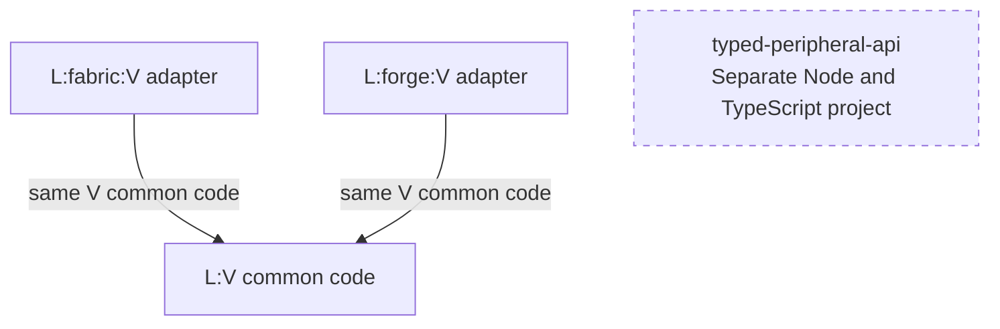
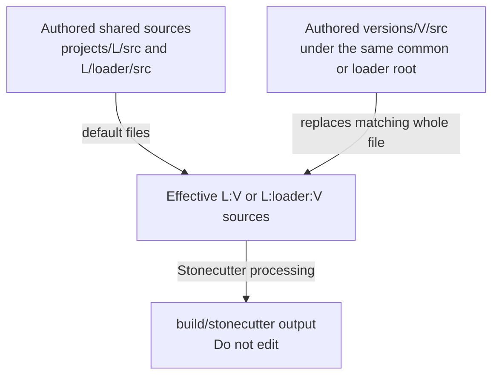

# Version and loader topology

[Architecture overview](overview.md) · [Task map](../quickstart.md) · [Build and publication details](../build/stonecutter-publication.md)

## One pattern, four libraries

The following is a logical build/source view, not a Minecraft block/item render-model graph. Substitute `L` with broccolium, tweakium, peripheralium or testiarium and `V` with one maintained Minecraft version. An arrow means the adapter consumes matching common code, not that common code calls loader APIs. Fabric and Forge-family artifacts are alternatives, not dependencies on each other.

[Settings](../../settings.gradle.kts#L44-L75) defines all four libraries at 1.20.1, 1.21.1 and 26.1.2, each with common, fabric and forge leaves. The branch spelling `forge` is stable even where the implementation is NeoForge. The target convention's [adapter wiring](../../gradle/minecraft-26-1.gradle.kts#L185-L213) and the [shared source packaging](../../build.gradle.kts#L152-L169) bind adapters to matching common output. Production edges between libraries also use the same `V` and matching adapter family; never mix version/loader artifacts just because the logical overview has one box per library.

| V | fabric leaf | forge leaf | Runtime JVM target |
| --- | --- | --- | --- |
| 1.20.1 | Fabric | Forge | 17 |
| 1.21.1 | Fabric | NeoForge | 21 |
| 26.1.2 | Fabric | NeoForge | 25 |

See [build contracts](../build/stonecutter-publication.md) for toolchain/runtime pins and publication evidence. `typed-peripheral-api` has its own [Node build and check tasks](../../projects/typed-peripheral-api/build.gradle.kts#L8-L50), not three sets of Minecraft leaves.

## Authored sources versus processed output

Canonical/VCS source is 1.20.1, not the newest Minecraft node. Read full-file `versions/V/src` overrides under the corresponding common or adapter root before changing or explaining behavior. [Root exclusion rules](../../build.gradle.kts#L52-L107) keep overridden shared files out of source/resource inputs even for the active node; generated resource roots are selected explicitly. Processed output under `build/stonecutter` is not a maintenance surface. The 26.1.2 leaves select the separate [target build convention](../../settings.gradle.kts#L68-L75), preserving legacy tooling on older nodes.

## Adapter drill-down

- [Broccolium loader integration](../broccolium/integrations/loaders.md): storage/platform delegation.
- [Tweakium loader integration](../tweakium/integrations/loaders.md): ComputerCraft and client registration.
- [Peripheralium loader integration](../peripheralium/integrations/loaders.md): concrete content registration.
- [Testiarium harness](../testiarium/harness.md) and [client/CCT fixtures](../testiarium/client-cct.md): test API versus fixture output.
- [Back to the project dependency overview](overview.md).

Solid arrows mean source consumption or processing as explicitly labeled. A dashed border marks a project outside the Minecraft graph. No diagram edge asserts wire compatibility, cross-loader saves or a class-level inheritance relationship.
