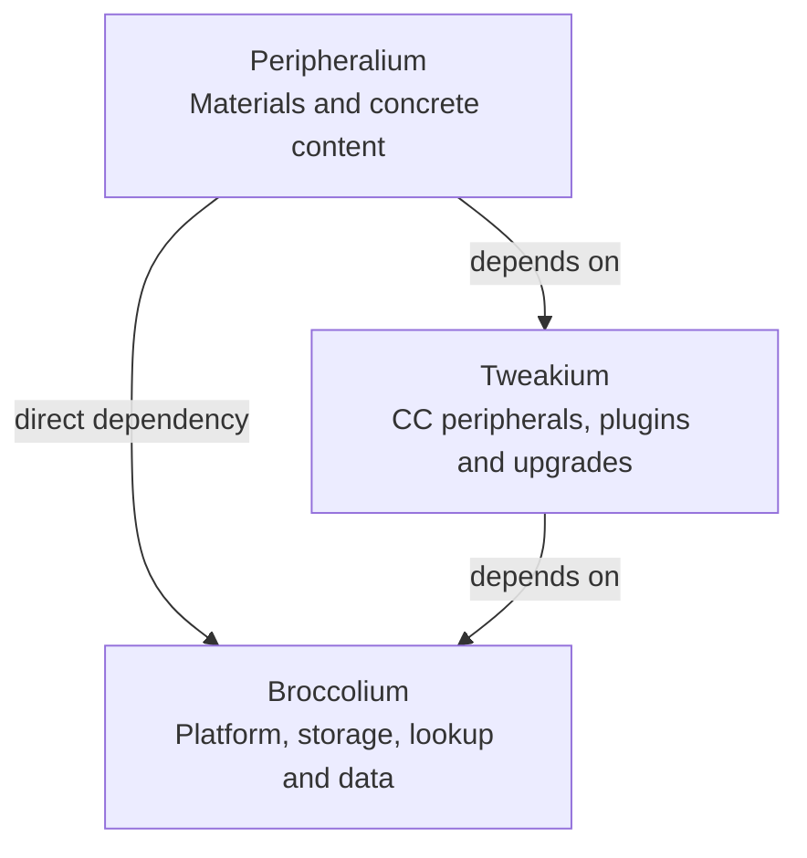
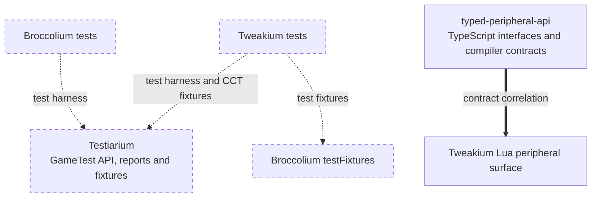

# Architecture overview

[Task map](../quickstart.md) · [Version and loader topology](loaders.md) · [Build/publication](../build/stonecutter-publication.md)

These are logical module and source-ownership diagrams, not Minecraft block/item rendering models. Follow [representation/RML](../tweakium/modules/representation-rml.md) for client rendering. Each library box collapses matching-version common and loader leaves; expand those on the [loader topology page](loaders.md).

## Production dependencies

Solid arrows point from consumer to provider. Peripheralium declares **both** dependencies; the direct Broccolium edge must not disappear into an assumed chain. The [legacy common declarations](../../projects/peripheralium/build.gradle.kts#L40-L45), [Tweakium declaration](../../projects/tweakium/build.gradle.kts#L51-L60) and [26.1.2 convention](../../gradle/minecraft-26-1.gradle.kts#L107-L128) establish these directions. Configuration details differ (legacy common `implementation`, target `api`, adapter common outputs); the boxes are not a claim that every Gradle configuration is identical.

## Tests and consumer contracts are different edges

Dashed arrows mean test-only consumption, not runtime library dependencies; dashed boxes identify test surfaces. The thick arrow means independently maintained consumer-contract correlation, not generated declarations, Kotlin compilation dependency or runtime certification. Read [Broccolium's test wiring](../../projects/broccolium/fabric/build.gradle.kts#L54-L67), [Tweakium fixture wiring](../../projects/tweakium/fabric/build.gradle.kts#L43-L69), [target wiring](../../gradle/minecraft-26-1.gradle.kts#L136-L165) and [TypeScript contracts](../../projects/typed-peripheral-api/tests/contracts.ts#L60-L99). Testiarium's [main API and optional fixture features](../../projects/testiarium/build.gradle.kts#L21-L54) are separate outputs. Peripheralium content tests can execute through Tweakium's runner; this does not create a reverse production dependency.

## Drill down by responsibility

These normal Markdown links work without JavaScript, color perception or diagram clicking. Each project entry page links back here.

| Project | Entry and focused modules | Boundary to keep in mind |
| --- | --- | --- |
| Broccolium | [Platform/lifecycle](../broccolium/modules/platform-base.md), [storage](../broccolium/modules/storage.md), [lookup/drops](../broccolium/modules/lookup-drops.md), [data](../broccolium/modules/data.md), [adapters](../broccolium/integrations/loaders.md) | Loader-neutral abstractions versus native storage/registration |
| Tweakium | [Peripheral ownership/dispatch](../tweakium/modules/peripheral.md), [plugins/operations](../tweakium/modules/plugins.md), [fake player](../tweakium/modules/player.md), [platform/data](../tweakium/modules/platform-data.md), [representation/RML](../tweakium/modules/representation-rml.md), [upgrade persistence](../tweakium/modules/upgrades-persistence.md), [adapters](../tweakium/integrations/loaders.md) | Logical owner/plugin model is separate from client render models |
| Peripheralium | [Content/resources](../peripheralium/content.md), [adapters](../peripheralium/integrations/loaders.md) | Concrete materials/content, not generic Lua dispatch |
| Testiarium | [Harness and reports](../testiarium/harness.md), [client/CCT](../testiarium/client-cct.md) | Main API, testMod and cctTestMod are distinct |
| typed-peripheral-api | [Consumer contracts](../typed-peripheral-api/contracts.md) | Independent Node/TypeScript package, outside Stonecutter |

## Reading and verification routes

Start with [version/loader topology](loaders.md) before inspecting implementation overrides. Use [verification](../testing/verification.md) for executable gates and the [diagram coverage checklist](../../docs/verification/openwiki-diagrams.md) for completed overview scope versus later class/flow ownership. Current diagrams summarize build declarations; no application tests were run merely to draw them.
