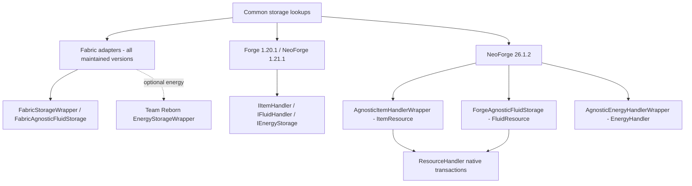
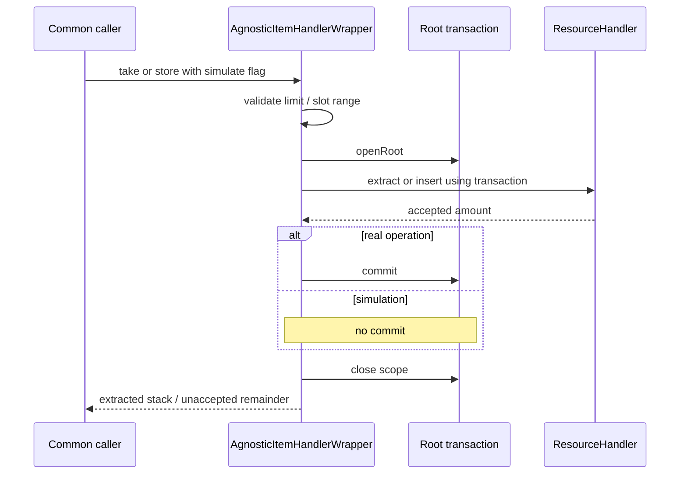

# Broccolium loader integration

[Architecture overview](../../architecture/overview.md) · [Version/loader topology](../../architecture/loaders.md) · [Storage classes and generic transfer](../modules/storage.md)

## Native delegation map

Arrows mean “adapts/delegates to”, not class inheritance. A common caller sees item, fluid or energy storage; the effective loader file chooses a native backend. These are alternative routes, not interchangeable transaction protocols.

The old Forge-family item adapter passes `simulate` to `extractItem`/`insertItem`; it does not start a native transaction. Target NeoForge item/fluid/energy wrappers open a root transaction per take/store and commit only real operations. Their inherited common `moveTo` still uses the generic two-phase algorithm: per-call native rollback does not make the whole cross-storage transfer atomic. Fabric item-to-item native wrappers select `StorageUtil.move`; mixed peers select explicit extract/store/remainder bridges instead.

Evidence: [Fabric routing](../../../projects/broccolium/fabric/src/main/kotlin/site/siredvin/broccolium/modules/storage/item/FabricStorageWrapper.kt#L24-L103), [mixed peer bridge](../../../projects/broccolium/fabric/src/main/kotlin/site/siredvin/broccolium/modules/storage/FabricStorageUtils.kt#L48-L109), [1.21.1 handler](../../../projects/broccolium/forge/versions/1.21.1/src/main/kotlin/site/siredvin/broccolium/modules/storage/item/AgnosticItemHandlerWrapper.kt#L10-L60), [target lookup](../../../projects/broccolium/forge/versions/26.1.2/src/main/kotlin/site/siredvin/broccolium/modules/storage/ForgeStorageUtils.kt#L22-L80), [target energy](../../../projects/broccolium/forge/versions/26.1.2/src/main/kotlin/site/siredvin/broccolium/modules/storage/energy/AgnosticEnergyHandlerWrapper.kt#L14-L38).

### One target native mutation, not a distributed transaction

The target item extraction also uses an uncommitted nested preview before testing the predicate. The [implementation](../../../projects/broccolium/forge/versions/26.1.2/src/main/kotlin/site/siredvin/broccolium/modules/storage/item/AgnosticItemHandlerWrapper.kt#L11-L53) and [adapter regression source](../../../projects/broccolium/forge/versions/26.1.2/src/test/kotlin/site/siredvin/broccolium/modules/storage/item/NeoForgeTargetAdapterTests.kt#L29-L120) distinguish simulation, full remainders, nested abort and real bucket origin replacement. These tests were inspected, not rerun for this documentation change. Exact origin-slot replacement and its restrictions are explained in [storage](../modules/storage.md#exact-replacement-and-target-transactions).

## Maintained source boundaries

The four library trees retain Fabric/Forge1.20.1 and Fabric/NeoForge1.21.1, adding exact26.1.2 Fabric/NeoForge. The `forge` branch name remains historical. Inspect the matching `versions/<version>/src` override before changing an adapter; common callers use platform/storage abstractions, not loader imports.

Fabric bootstrap configures common toolkit/lookups and optional Team Reborn integration. Forge-family bootstrap installs native capability lookups. Nullable sides are real lookup contexts, not an invented UP direction. Target adapters reject removed block entities. Native origin slots are preserved for item-contained resources; target NeoForge uses transactional ResourceHandler/ItemAccess/EnergyHandler rather than mechanically wrapping old handlers.

## Positive integration evidence

[R2 native acceptance](../../../docs/verification/minecraft-26-1-R2.md) covers actual positive item/fluid/energy providers, nested rollback, component-bearing variants, origin bucket replacement, nullable sides and invalid/removed providers. Energy dependencies remain3.0.0 on1.20.1,4.1.0 on1.21.1 and5.0.0 on26.1.2. The earlier absent-provider smoke is not the whole proof.

Official target wideners/transformers and native removal descriptors are checked against packaged/transformed classes. Universal artifacts contain gated client APIs; dedicated-server readiness is separately demonstrated in [final verification](../../../docs/minecraft-26-1-verification.md), not inferred from compilation.

## Limits and navigation

Exact replacement requires stable/restorable backing storage; setter notifications and arbitrary cross-adapter peers are not automatically transactional. Do not infer certification of every optional provider or protection mod. See [storage contracts](../modules/storage.md), [lookup/drop capture](../modules/lookup-drops.md) and [build/publication](../../build/stonecutter-publication.md).
