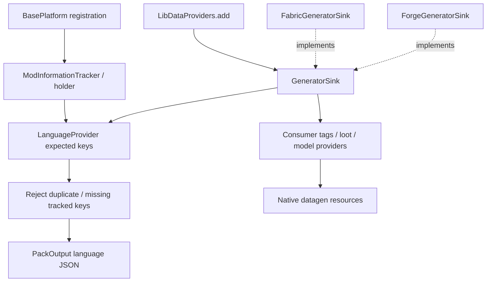

# Broccolium data generation

[Architecture overview](../../architecture/overview.md) · [Version/loader topology](../../architecture/loaders.md)

## Ownership and validation

### Provider composition and build-time flow

This is a build-time responsibility map, not the client rendering pipeline. Solid arrows show calls/data inputs; dashed arrows show the loader sink implementing the common interface. There is no world-save sequence here: generator output is resource JSON, not persistent game state.

Broccolium itself registers only the English/Ukrainian factories through [LibDataProviders](../../../projects/broccolium/src/main/kotlin/site/siredvin/broccolium/modules/data/LibDataProviders.kt#L5-L9); the model/tag/loot branches are extension seams for consuming libraries. [LanguageProvider](../../../projects/broccolium/src/main/kotlin/site/siredvin/broccolium/modules/data/lang/LanguageProvider.kt#L14-L50) performs expected-key validation before saving. Registration tracking is selective: the canonical named block helper tracks its supplier, while the explicit keyed overload delegates directly; do not infer that every route populates every expected-key list ([BasePlatform](../../../projects/broccolium/src/main/kotlin/site/siredvin/broccolium/modules/platform/BasePlatform.kt#L32-L46)).

On 26.1.2 [FabricGeneratorSink](../../../projects/broccolium/fabric/versions/26.1.2/src/main/kotlin/site/siredvin/broccolium/modules/data/FabricGeneratorSink.kt#L28-L45) uses a pack and registry future; [ForgeGeneratorSink](../../../projects/broccolium/forge/versions/26.1.2/src/main/kotlin/site/siredvin/broccolium/modules/data/ForgeGeneratorSink.kt#L27-L38) uses the gather event/provider registry future. Its [client-only model gate](../../../projects/broccolium/forge/versions/26.1.2/src/main/kotlin/site/siredvin/broccolium/modules/data/ForgeGeneratorSink.kt#L88-L91) registers skipped providers too, preserving the model cache through the server stale-file purge. This is distinct from old provider signatures and from choosing effective generated roots below.

GeneratorSink is the loader-neutral composition boundary for provider factories, tags, loot, models and registry patches. Broccolium's own concrete provider list generates English/Ukrainian language resources; dependent libraries own their content providers. Language generation rejects duplicates and missing expected tracked keys, not every possible untracked runtime string. Registration tracking therefore matters.

Model collectors reject duplicate definitions and synthesize delegated item models only where needed. The target adapts registry-aware recipes, loot and client item/model APIs with typed overrides; NeoForge client/server datagen and Fabric providers are distinct adapter routes. Update the provider rather than hand-editing `src/generated`.

## Effective roots and deterministic output

Stonecutter's full-file overrides apply to generated resources too. An inactive source-root substitution previously omitted old languages or leaked legacy models. The repository now selects authored generated roots explicitly and verifies packaged output in all three active states. This is separate from compilation source exclusion.

[R5](../../../docs/verification/minecraft-26-1-R5.md) executes40 actual generator tasks across12 commands/two passes over all six loader/version pairs, validating96 selected production JSON resources at that baseline. Old Tweakium has no concrete production generator: abstract utility presence is not an executed provider. [Final R7 integration](../../../docs/verification/minecraft-26-1-R7-final-integration.md) repeats24 target tasks after the approved target Filler generator/resource change. Exact before/after inventories agree; historical and replay counts overlap and must not be summed as unique assets.

See [Peripheralium content](../../peripheralium/content.md), [Tweakium generated data](../../tweakium/modules/platform-data.md), [platform tracking](platform-base.md) and [source/publication ownership](../../build/stonecutter-publication.md).
