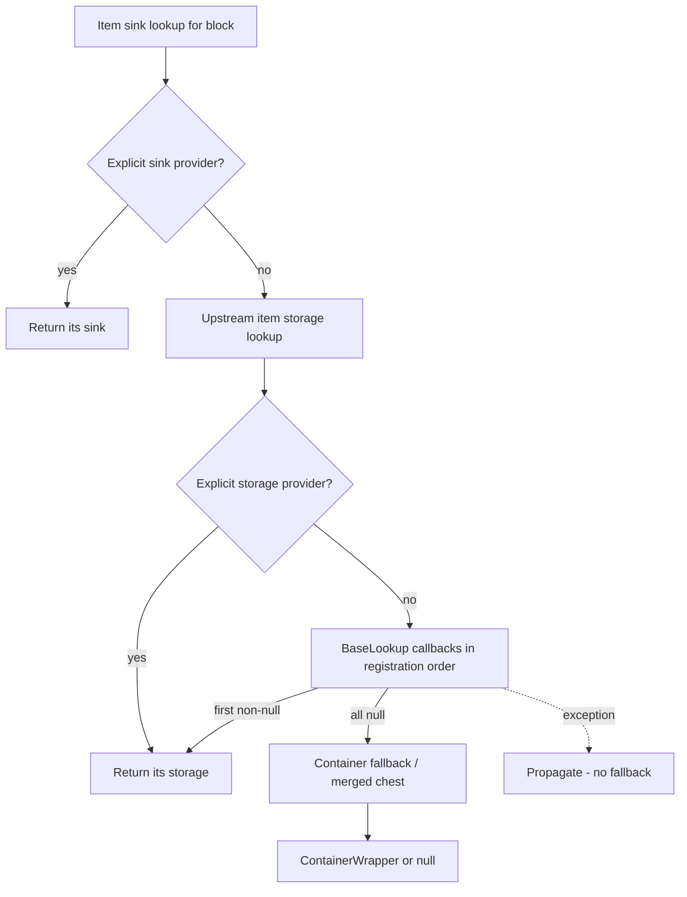
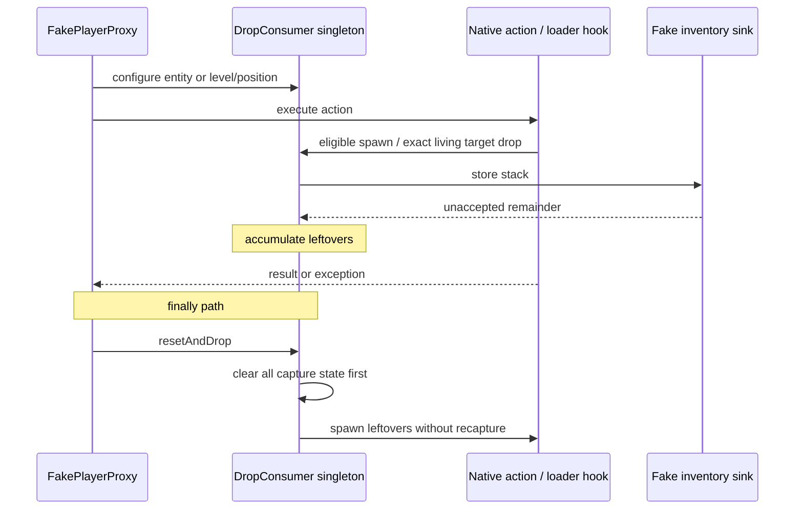

# Broccolium lookup and drop capture

[Architecture overview](../../architecture/overview.md) · [Broccolium platform map](platform-base.md) · [Storage families](storage.md)

## Resolution drill-down

The item-block path below spells out priority rather than suggesting all lookups run in parallel. Solid arrows are control flow. `ChainedBaseLookup` owns an upstream lookup reference; concrete item sink lookup specializes it with the storage lookup. Fluid/energy have their own lookup families and must not be inferred to share every item fallback.

Evidence: [sink override](../../../projects/broccolium/src/main/kotlin/site/siredvin/broccolium/modules/storage/item/AgnosticItemSinkLookup.kt#L13-L24), [upstream-first chaining](../../../projects/broccolium/src/main/kotlin/site/siredvin/broccolium/modules/lookup/ChainedBaseLookup.kt#L11-L41), [ordered dispatch and unsupported-object refusal](../../../projects/broccolium/src/main/kotlin/site/siredvin/broccolium/modules/lookup/BaseLookup.kt#L28-L71), [target block fallback](../../../projects/broccolium/versions/26.1.2/src/main/kotlin/site/siredvin/broccolium/modules/storage/item/AgnosticItemStorageLookup.kt#L33-L63). Target storage lookup refuses removed entities/block entities; the diagram starts after that guard. The sink-provider override is a separate priority path, not proof every provider is guarded there.

Entity fallback is version-sensitive: [canonical horse inventory](../../../projects/broccolium/src/main/kotlin/site/siredvin/broccolium/modules/storage/item/AgnosticItemStorageLookup.kt#L20-L34) excludes the first two legacy slots, whereas [26.1.2](../../../projects/broccolium/versions/26.1.2/src/main/kotlin/site/siredvin/broccolium/modules/storage/item/AgnosticItemStorageLookup.kt#L20-L30) wraps all cargo slots because equipment moved elsewhere. Loader callbacks may return before either fallback.

## Capture state flow

The two [action wrappers](../../../projects/tweakium/versions/26.1.2/src/main/kotlin/site/siredvin/tweakium/modules/player/FakePlayerProxy.kt#L60-L75) release capture in `finally`; [DropConsumer](../../../projects/broccolium/src/main/kotlin/site/siredvin/broccolium/modules/tricks/DropConsumer.kt#L18-L73) owns the global state, exact entity check and reset-before-spawn ordering. This is not a stack of nested sessions or thread-local isolation. The sequence does not promise callback compensation or inventory rollback. [Player session reconciliation](../../tweakium/modules/player.md) is another scope entirely.

## Lookup contract

BaseLookup keeps separate block/entity/inventory-item callback lists, tries registered callbacks in order and returns the first non-null result. Null permits fallback; an extractor exception aborts resolution. Unknown-object dispatch handles supported positions/block entities/entities, not arbitrary objects as implicit containers. Chained lookups prefer upstream results, while explicit agnostic sink/storage providers have their own priority.

Read the selected version's entity fallback. Target horse cargo is the full native cargo container; equipment is separate and must not be removed by subtracting legacy slots. Native chest-minecart capability and player/container inventory cases remain explicit regressions. [R2](../../../docs/verification/minecraft-26-1-R2.md) audits modern overrides and proves horse/equipment/cargo/native lookup behavior rather than inferring it from a file count.

## Capture and cleanup

DropConsumer remains process-global mutable capture state, not thread-local or a nested capture service. Entity configuration retains the exact target; positional configuration clears it. Reset clears state before dropping remainders so leftovers do not recapture themselves. Captured contents follow the sink's remainder contract.

Fabric interception uses loader Mixins; Forge-family uses native spawn/living-drop hooks. Tweakium action wrappers release capture in finally on successful and exceptional actions. Native tests retain target identity, unrelated-entity refusal, exact remainder and one-drop behavior. Session inventory/attribute reconciliation is a separate [fake-player contract](../../tweakium/modules/player.md), not implied by capture cleanup.

Nested/concurrent capture and arbitrary third-party event behavior are not certified. See [storage](storage.md), [loader integration](../integrations/loaders.md) and [final evidence/limits](../../../docs/minecraft-26-1-verification.md).
