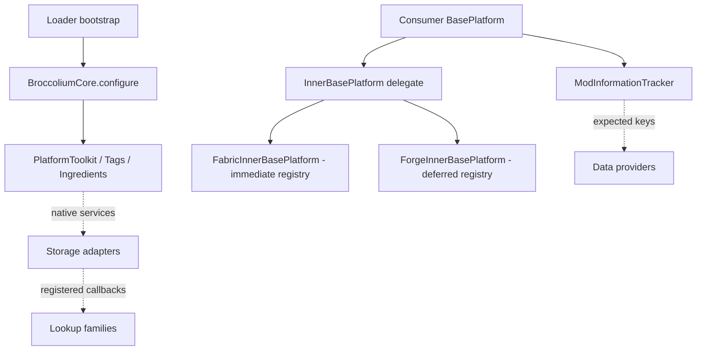
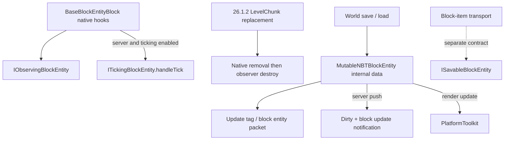

# Broccolium platform and block lifecycle

[Architecture overview](../../architecture/overview.md) · [Version/loader topology](../../architecture/loaders.md)

## Platform and registration

### Service and module map

Solid arrows mean a call, held reference or delegation as labeled; dashed arrows identify sibling systems reached through the common surface. The platform facade is not the global toolkit singleton. Configure services before calling `PlatformToolkit.get`, which throws if unconfigured.

Follow [storage classes and transfers](storage.md), [lookup/drop flow](lookup-drops.md), [data ownership](data.md), and [loader delegation](../integrations/loaders.md). Evidence: [service installation](../../../projects/broccolium/src/main/kotlin/site/siredvin/broccolium/BroccoliumCore.kt#L17-L20), [toolkit guard](../../../projects/broccolium/src/main/kotlin/site/siredvin/broccolium/modules/platform/PlatformToolkit.kt#L5-L16), [facade/tracker](../../../projects/broccolium/src/main/kotlin/site/siredvin/broccolium/modules/platform/BasePlatform.kt#L24-L46), target [Fabric registration](../../../projects/broccolium/fabric/versions/26.1.2/src/main/kotlin/site/siredvin/broccolium/modules/platform/FabricInnerBasePlatform.kt#L28-L42) and [NeoForge deferred registration](../../../projects/broccolium/forge/versions/26.1.2/src/main/kotlin/site/siredvin/broccolium/modules/platform/ForgeInnerBasePlatform.kt#L27-L57). The version topology page explains which override supplies these adapters.

Broccolium explicitly installs toolkit/tag/ingredient implementations before lazy registry access. BasePlatform is a consuming mod's registration/tracking facade, not loader autodetection. Loader adapters own immediate Fabric versus deferred Forge-family registration and event-bus attachment. Target block/item properties receive keys before construction. Common services remain loader-neutral.

## Approved observer migration

Only26.1.2 changes `IObservingBlockEntity.onNeighbourChange` to `(neighbourBlock: Block, orientation: Orientation?)`. Forward the exact native data, including null orientation. The native target hook cannot truthfully supply a causal neighbor BlockPos; never substitute the receiving position or synthesize six callbacks. Old1.20.1/1.21.1 consumers retain `(neighbour: BlockPos)` unchanged. Target consumers recompile and implement the new signature.

Target removal interception is scoped to native replacement, not generic `setRemoved`/chunk unload. [R2](../../../docs/verification/minecraft-26-1-R2.md) verifies same-block state updates, one destroy after removal, preserved drops, no unload destruction, supplier/registry codecs and all packaged access rules. LimitedInventory remains extensible.

## Persistence and sync

The observer callbacks are optional interfaces on the entity, not a parent class forcing every hook. [Target block hooks](../../../projects/broccolium/versions/26.1.2/src/main/kotlin/site/siredvin/broccolium/modules/base/block/BaseBlockEntityBlock.kt#L30-L92) gate ticking on server/enabled, forward nullable native orientation, and assign player ownership on server placement. [Target replacement interception](../../../projects/broccolium/versions/26.1.2/src/main/java/site/siredvin/broccolium/modules/base/mixin/LevelChunkMixin.java#L14-L29) removes the native entity before `destroy`; it is not an unload handler. [Mutable data hooks](../../../projects/broccolium/versions/26.1.2/src/main/kotlin/site/siredvin/broccolium/modules/base/blockentity/MutableNBTBlockEntity.kt#L24-L62) keep root payload keys and gate mutation notifications to the server. [Observer regression source](../../../projects/broccolium/versions/26.1.2/src/test/kotlin/site/siredvin/broccolium/test/ObserverCallbackTests.kt#L40-L71) checks exact/null forwarding; native lifecycle acceptance is linked above, not rerun here.

MutableNBTBlockEntity bridges internal settings into world save/load/update tags. Target ValueInput/ValueOutput uses a root codec to preserve existing payload keys; old version-specific NBT/provider signatures remain. World persistence, prepared block-item transport and client synchronization are separate paths. No new SavedData/attachment owner or custom file relocation was introduced.

Copied/staged save upgrades and process restart evidence live in [final verification](../../../docs/minecraft-26-1-verification.md); they do not guarantee downgrade, arbitrary saves or every loot/piston path. See [data generation](data.md), [menu/network evidence](../../testing/verification.md) and [Tweakium settings](../../tweakium/modules/upgrades-persistence.md).
