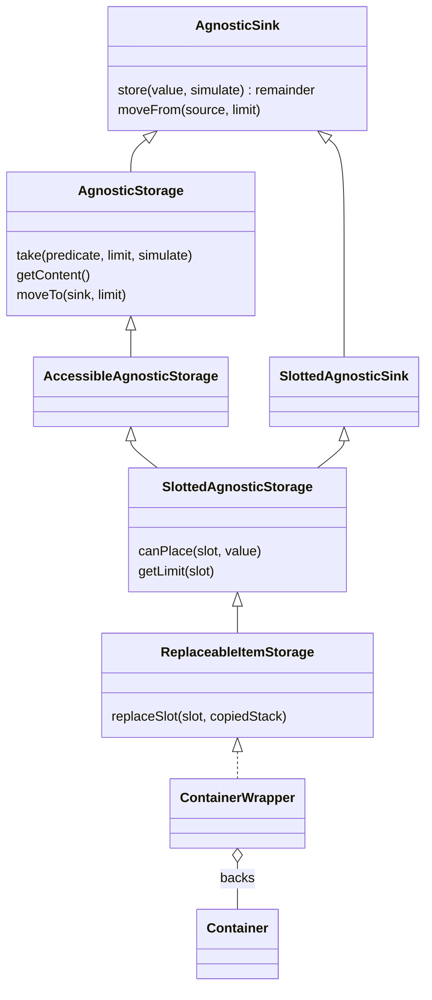
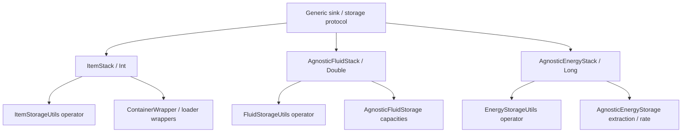
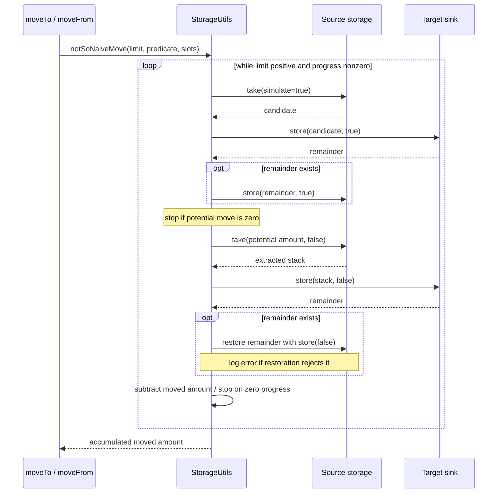

# Broccolium storage transfers

[Architecture overview](../../architecture/overview.md) · [Platform map](platform-base.md) · [Native delegation and commit sequence](../integrations/loaders.md)

## Focused storage class model

Hollow triangles mean interface extension/implementation; the diamond means a held backing reference, not exclusive lifetime ownership. Generic parameters are described in prose to keep labels readable. This is the logical storage model, not a Minecraft baked model.

[AgnosticSink](../../../projects/broccolium/src/main/kotlin/site/siredvin/broccolium/modules/storage/base/api/AgnosticSink.kt#L7-L30) owns the remainder/operator contract; [AgnosticStorage](../../../projects/broccolium/src/main/kotlin/site/siredvin/broccolium/modules/storage/base/api/AgnosticStorage.kt#L7-L25) and [slotted extension](../../../projects/broccolium/src/main/kotlin/site/siredvin/broccolium/modules/storage/base/api/SlottedAgnosticStorage.kt#L8-L39) choose generic versus specialized movement via `movableType`. [ContainerWrapper](../../../projects/broccolium/src/main/kotlin/site/siredvin/broccolium/modules/storage/item/ContainerWrapper.kt#L13-L40) delegates native slots; [ReplaceableItemStorage](../../../projects/broccolium/src/main/kotlin/site/siredvin/broccolium/modules/storage/item/ReplaceableItemStorage.kt#L6-L31) is stricter than ordinary insertion.

### Resource families

Item storage uses the generic slotted contract; fluid and energy expose [specialized capacities](../../../projects/broccolium/src/main/kotlin/site/siredvin/broccolium/modules/storage/fluid/api/AgnosticFluidStorage.kt#L3-L7) and [extraction/rate](../../../projects/broccolium/src/main/kotlin/site/siredvin/broccolium/modules/storage/energy/api/AgnosticEnergyStorage.kt#L3-L13) seams. Native wrappers, conversions and exact version differences are in [loader integration](../integrations/loaders.md#native-delegation-map); the item template definition API is not a runtime inventory value.

## Generic transfer sequence

This is the ordinary no-`movableType` path in [StorageUtils](../../../projects/broccolium/src/main/kotlin/site/siredvin/broccolium/modules/storage/base/StorageUtils.kt#L13-L71). A simulation is an assumption about cooperative peer behavior, not a reservation. The actual pass can disagree; failed restore is logged and no distributed rollback exists. [Shared test fixtures](../../../projects/broccolium/src/testFixtures/kotlin/site/siredvin/broccolium/test/StorageTests.kt#L130-L202) compare simulation/action and transfer contents. Native transactional item paths and target per-call commit scopes are shown separately in [loader integration](../integrations/loaders.md#one-target-native-mutation-not-a-distributed-transaction).

## Common runtime contract

AgnosticSink returns an unaccepted remainder; AgnosticStorage adds extraction/content iteration and slotted variants add admission/capacity/range contracts. Runtime item values stay ItemStack, not ItemStackTemplate. Fluid amounts are compact Double quantities converted at native boundaries; energy is Long with explicit conversion edges. Review units and rounding at the adapter, not only Lua's number type.

Ordinary generic transfers simulate before real mutation and attempt to restore remainders. This is not universal atomicity: adverse peers can reject restoration. A native transaction on one side does not enlist an arbitrary external backend.

## Exact replacement and target transactions

ReplaceableItemStorage is an explicit opt-in to exact copied slot replacement, including empty/data changes and restoration. Reverse adapters reject unsupported backings before mutation; ordinary additive store cannot restore a snapshot. Backing layout/contents/limits must remain stable and captured variants restorable. Setter notifications/callbacks are not themselves rolled back.

Fabric preserves native slot transaction participants instead of wrapping origins unnecessarily. Target NeoForge adapts ResourceHandler, ItemResource/FluidResource and EnergyHandler with native transaction ownership. ItemAccess replaces the origin slot when containers change, including restoring components/counts on abort. Simulation does not commit; nested abort/commit is exercised rather than inferred from an interface name.

## Evidence and limits

[R2](../../../docs/verification/minecraft-26-1-R2.md) covers positive providers, nested rollback, limits, component variants, nullable sides, removed providers and container replacement. The assembled [R6 matrix](../../../docs/verification/minecraft-26-1-R6.md) contains99 storage cases with zero skips. Final candidate sources/artifacts are rebound through [R7 integration](../../../docs/verification/minecraft-26-1-R7-final-integration.md). This is not certification of arbitrary third-party or independently mutating backings.

See [lookup](lookup-drops.md), [loaders](../integrations/loaders.md) and [Lua validation/units](../../tweakium/modules/plugins.md).
