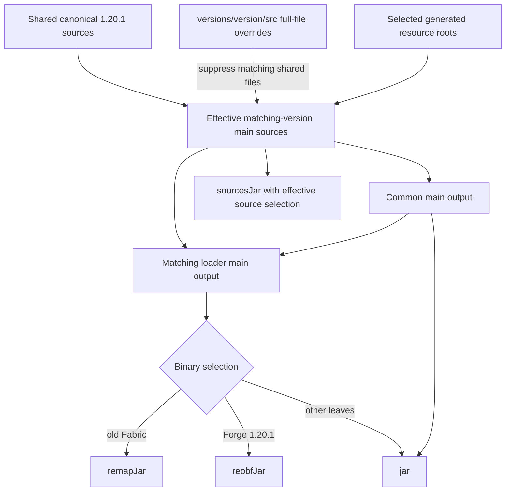
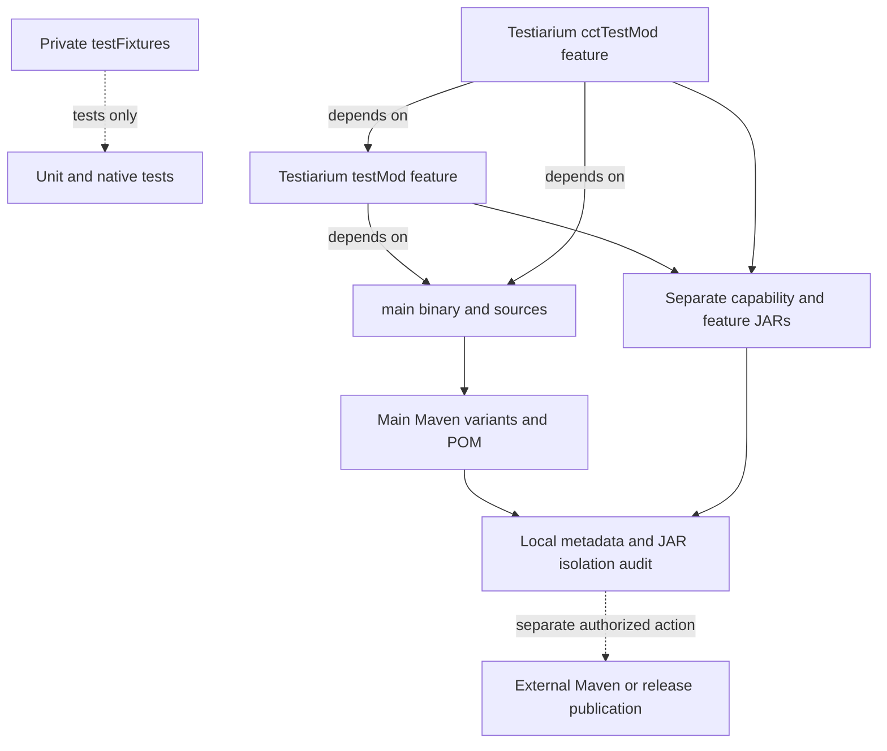

# Stonecutter source ownership and publications

[Architecture overview](../architecture/overview.md) · [Version/loader topology](../architecture/loaders.md)

## Effective graph

Four libraries have common/Fabric/forge nodes at1.20.1,1.21.1 and26.1.2; TypeScript is independent. Forge means legacy Forge on1.20.1, NeoForge on newer nodes. Canonical/VCS state stays1.20.1. Tasks use `:<library>:<version>:<task>` or `:<library>:<loader>:<version>:<task>`. Full-file authored version overrides suppress matching shared code/resources/sources, including active nodes. Explicit generated-resource roots prevent inactive-node language loss or legacy model leakage.

## Source-to-artifact flow

This refines the [source topology](../architecture/loaders.md#authored-sources-versus-processed-output): read authored inputs, never edit processed Stonecutter output. [Root selection](../../build.gradle.kts#L52-L107) applies full-file suppression to source/resources and selects generated roots explicitly; [loader sources](../../build.gradle.kts#L152-L169) include matching common sources. [Aggregate release selection](../../build.gradle.kts#L231-L245) chooses the production binary and sources for every leaf, including common leaves. This is a configured flow, not an executed release receipt.

### Main output versus test features

Solid arrows here mean artifact flow or explicitly labeled feature dependency, not the overview's production module dependency direction. Dashed edges distinguish test-only use and an unexecuted publication boundary. [Private fixture publication is disabled](../../gradle/minecraft-26-1.gradle.kts#L149-L166); [Testiarium features](../../projects/testiarium/build.gradle.kts#L21-L51) and [root capability wiring](../../build.gradle.kts#L112-L148) keep optional outputs separate. [check-publications.py](../../scripts/check-publications.py#L23-L70) checks main archive fixture leakage, bytecode and loader metadata; [variant checks](../../scripts/check-publications.py#L73-L128) inspect coordinates and dependencies. A successful local check neither uploads anything nor proves production startup. Follow [verification routes](../testing/verification.md#verification-route-map) for those separate gates.

## Target tooling details

`gradle/minecraft-26-1.gradle.kts` owns12 target leaves. Common/Fabric use Loom1.17.11 non-remapping, official access rules, no mappings dependency and ordinary jar/configurations. Target NeoForge uses MDG2.0.142 without old Parchment. Old remapping paths remain. Java25 launcher/KGP2.4.0 preserve old JVM17/21, language/API2.0 and runtime pins; target JVM25. [R0](../../docs/verification/minecraft-26-1-R0.md) verifies loaded plugins and72 resolved graphs, not catalog intent.

## Artifacts and evidence

Public group stays site.siredvin; read current library versions from gradle.properties rather than treating the historical R5 version2.0.0 as a permanent pin. Historical forge suffix stays, Testiarium common is core. Separate main/testMod/cctTestMod capabilities and sources remain. Check exact compiled fixture identities and all POM/GMM variants; viewers/private fixtures must not leak into production metadata.

[R5](../../docs/verification/minecraft-26-1-R5.md) proves36 publications,118 JARs,9 external Java/Kotlin routes,10 raw outgoing consumers, three active-state full builds and canonical restoration. [Final R7 integration](../../docs/verification/minecraft-26-1-R7-final-integration.md) refreshes affected final artifacts/consumers/publications. Two source-ZIP order limits remain: no blanket final118-byte reproducibility claim.

The current [aggregate release wiring](../../build.gradle.kts#L210-L245) selects every version leaf, using remapJar for old Fabric, reobfJar for Forge1.20.1 and jar otherwise, plus sourcesJar. Configuration is not proof of an executed remote release. R5/R7 evidence above describes local validation at those historical source revisions, not current remote publication state.

Use wrapper --no-daemon, deadlines and fresh reports. Switching/datagen/builds mutate state and are not documentation linters. No public publish/push/release was performed during this documentation update. See [verification](../testing/verification.md), [harness](../testiarium/harness.md) and [quickstart](../quickstart.md).
