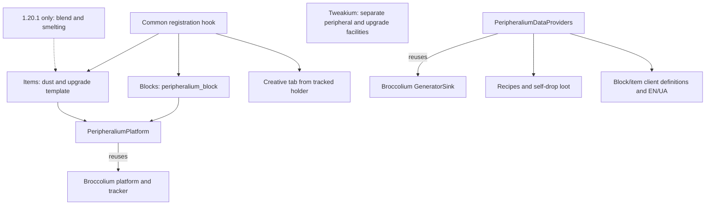
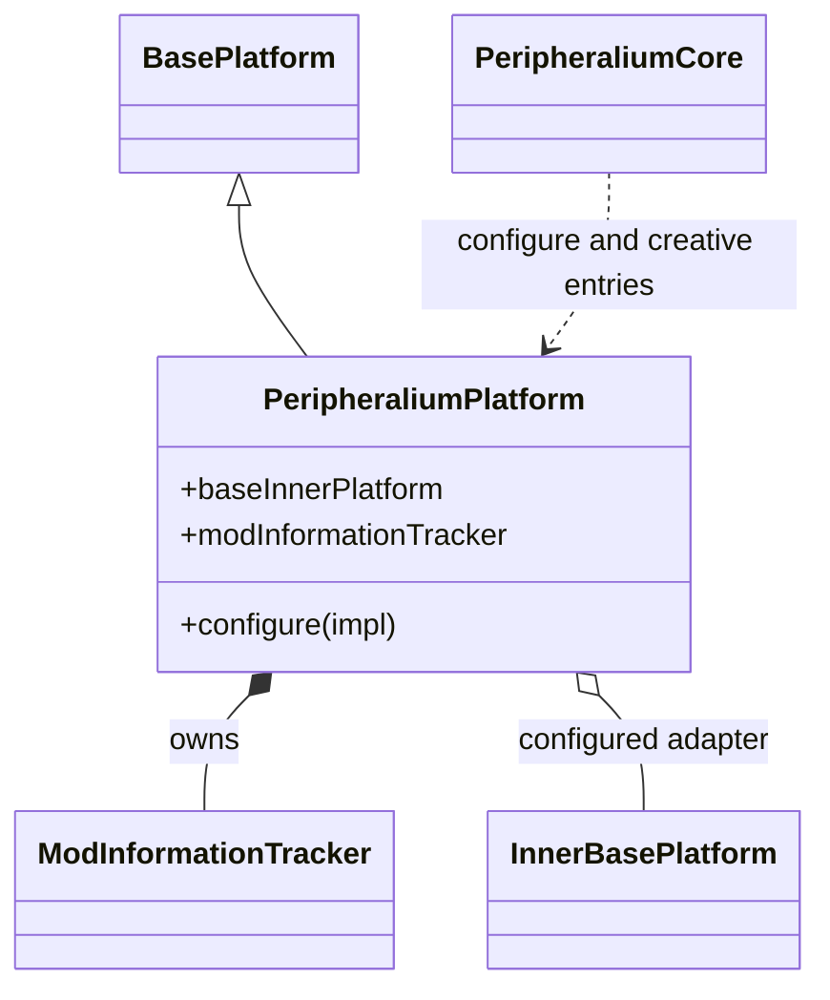
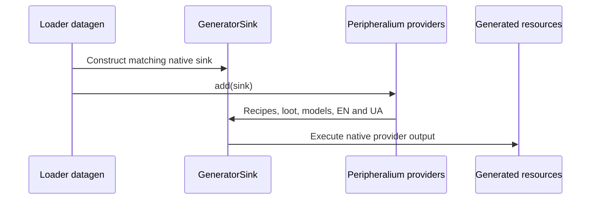

# Peripheralium content and resources

[Architecture overview](../architecture/overview.md) · [Version/loader topology](../architecture/loaders.md)

## Ownership

Peripheralium supplies materials and depends on matching Broccolium/Tweakium; generic peripheral dispatch belongs to Tweakium. All maintained lines contain peripheralium_block, peripheralium_dust and peripheralium_upgrade_template. Blend and its smelting recipe remain1.20.1-only; target26.1.2 preserves modern absence rather than inheriting legacy fallback.

Configure its platform before common content/tab registration. Target factories supply keys before native block/item construction, and owning loader adapters attach deferred registries. The holder drives creative entries and data validation.

## Content and provider map

Arrows mean registration/composition or labeled reuse, not a new dependency graph. The unconnected Tweakium box is intentionally not a content-registration call. The [common hook](../../projects/peripheralium/versions/26.1.2/src/main/kotlin/site/siredvin/peripheralium/PeripheraliumCommonHooks.kt#L6-L14) forces block/item singleton initialization before tab registration. [Creative entries](../../projects/peripheralium/src/main/kotlin/site/siredvin/peripheralium/PeripheraliumCore.kt#L14-L23) enumerate the platform holder rather than a second manual item list. Legacy [items](../../projects/peripheralium/src/main/kotlin/site/siredvin/peripheralium/Items.kt#L6-L15) and [smelting](../../projects/peripheralium/src/main/kotlin/site/siredvin/peripheralium/data/PeripheraliumRecipeProvider.kt#L20-L42) differ from [1.21.1 items](../../projects/peripheralium/versions/1.21.1/src/main/kotlin/site/siredvin/peripheralium/Items.kt#L6-L14) and [target recipes](../../projects/peripheralium/versions/26.1.2/src/main/kotlin/site/siredvin/peripheralium/data/PeripheraliumRecipeProvider.kt#L23-L41).

### Focused platform composition

[PeripheraliumPlatform](../../projects/peripheralium/src/main/kotlin/site/siredvin/peripheralium/PeripheraliumPlatform.kt#L7-L17) requires configuration before its non-null native delegate is read. This small class model is the extension seam; material objects are registry content, not an invented peripheral hierarchy. Continue to the [loader registration sequence](integrations/loaders.md#registration-sequence) and reusable [Broccolium platform](../broccolium/modules/platform-base.md#service-and-module-map).

### Data generation is a separate lifecycle

[Provider composition](../../projects/peripheralium/versions/26.1.2/src/main/kotlin/site/siredvin/peripheralium/data/PeripheraliumDataProviders.kt#L5-L12) is shared by the target [Fabric entrypoint](../../projects/peripheralium/fabric/versions/26.1.2/src/main/kotlin/site/siredvin/peripheralium/PeripheraliumDataGenerator.kt#L8-L11) and [NeoForge events](../../projects/peripheralium/forge/versions/26.1.2/src/main/kotlin/site/siredvin/peripheralium/ForgePeripheraliumDataGenerators.kt#L9-L19). These model definitions are resource generation, not Tweakium's client render execution. Native fixture checks are evidence of behavior only when actually run.

## Provider behavior and inherited evidence

Owning providers compose recipes, self-drop loot, block/item/client definitions and EN/UA languages through Broccolium. Dust crafting, block compression/decompression and four-template crafting retain their IDs/inputs/counts. Update generators, never hand-edit generated resources.

[R4](../../docs/verification/minecraft-26-1-R4.md) ports all target branches and verifies native registration/tracker identity, loaded/emitted recipes, loot and deterministic language/model inventories on both loaders. Peripheralium owns fixtures that execute through Tweakium's native runner; no reverse production cycle.

[Final R7 integration](../../docs/verification/minecraft-26-1-R7-final-integration.md) also verifies actual creative/content/book/menu interactions and refreshes affected data/publication/process evidence. External datapacks and recipe-transfer automation are not certified.

See [loaders](integrations/loaders.md), [Broccolium data](../broccolium/modules/data.md), [Tweakium dispatch](../tweakium/modules/peripheral.md) and [final limits](../../docs/minecraft-26-1-verification.md).
