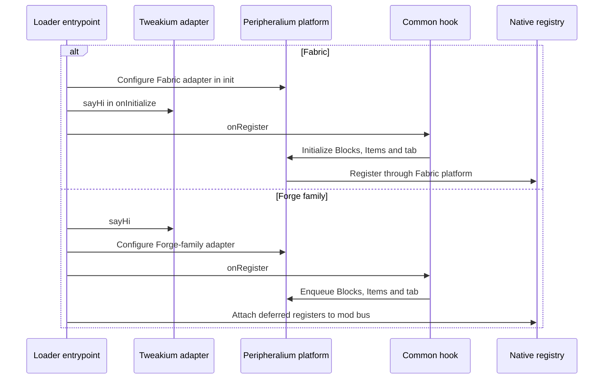
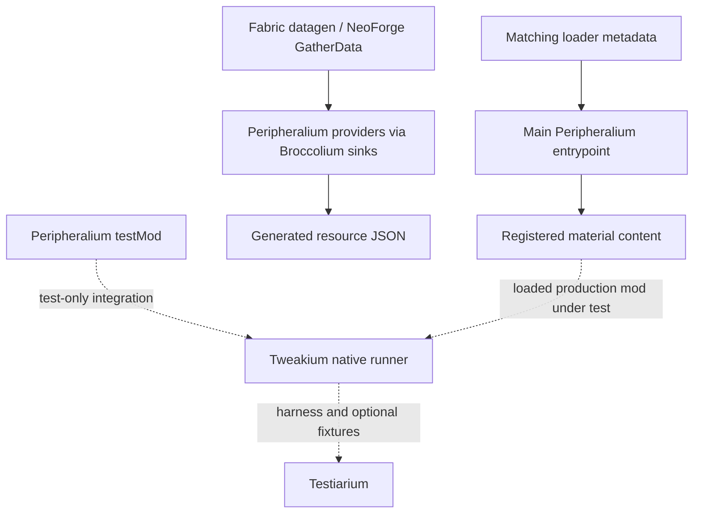

# Peripheralium loader integration

[Architecture overview](../../architecture/overview.md) · [Content/provider map](../content.md#content-and-provider-map)

## Registration sequence

The branches deliberately preserve the different dependency/configuration order in [Fabric](../../../projects/peripheralium/fabric/src/main/kotlin/site/siredvin/peripheralium/FabricPeripheralium.kt#L6-L19), [Forge 1.20.1](../../../projects/peripheralium/forge/src/main/kotlin/site/siredvin/peripheralium/ForgePeripheralium.kt#L18-L37), [NeoForge 1.21.1](../../../projects/peripheralium/forge/versions/1.21.1/src/main/kotlin/site/siredvin/peripheralium/ForgePeripheralium.kt#L16-L38) and [26.1.2](../../../projects/peripheralium/forge/versions/26.1.2/src/main/kotlin/site/siredvin/peripheralium/ForgePeripheralium.kt#L15-L33). Modern adapters also attach a criterion-trigger register; the old entrypoint does not have that register. Configuring before the common hook is the shared invariant, not identical loader execution. Target [block](../../../projects/peripheralium/versions/26.1.2/src/main/kotlin/site/siredvin/peripheralium/Blocks.kt#L9-L16) and [item](../../../projects/peripheralium/versions/26.1.2/src/main/kotlin/site/siredvin/peripheralium/Items.kt#L9-L19) factories provide registry keys before construction.

### Runtime, datagen and test entrypoints are different routes

Solid arrows are production/datagen routes; dashed arrows are test-runner assembly. [Fabric metadata](../../../projects/peripheralium/fabric/versions/26.1.2/src/main/resources/fabric.mod.json#L17-L29) separates main from fabric-datagen and pins the target Java/Minecraft boundary. [Legacy Fabric test wiring](../../../projects/peripheralium/fabric/build.gradle.kts#L93-L100) adds fixture output only to the integration runner; target content/fixture runner assembly is in the [shared convention](../../../gradle/minecraft-26-1.gradle.kts#L473-L492). See [feature/artifact isolation](../../build/stonecutter-publication.md#main-output-versus-test-features), not a new production Testiarium edge.

## Registration and metadata

Fabric configures the platform before common registration and forces dependency initialization through established adapters. Forge-family supplies deferred block/item/tab registries (plus criterion triggers on modern nodes) and attaches them to its loader bus. Forge means legacy Forge only on1.20.1;1.21.1/26.1.2 use NeoForge. Keep loader imports out of common content and read matching version overrides.

Target keyed construction, loader schema and Java25 metadata are in26.1.2 overrides. Check actual packaged metadata/JVM69/dependencies: an old permissive metadata bound is not evidence old Java can load modern bytecode. Modern content intentionally omits legacy blend/smelting.

## Fixture and publication isolation

Peripheralium owns behavior/recipe fixtures. Native Tweakium runners load actual Peripheralium common/loader mod outputs plus matching test features; reverse integration stays test-only. Main JAR scans compare exact compiled fixture identities, and all POM/GMM variants are checked for test/viewer leakage.

[R4](../../../docs/verification/minecraft-26-1-R4.md) verifies both target adapters and deterministic data. [R5](../../../docs/verification/minecraft-26-1-R5.md) establishes full publication/consumer/active-state checks; [R7 integration](../../../docs/verification/minecraft-26-1-R7-final-integration.md) refreshes final publication/graphical/process proof. Development viewers follow approved EMI-old/JEI-target policy, no active REI dependency; they are not publication runtime requirements.

See [content](../content.md), [build](../../build/stonecutter-publication.md) and [verification](../../testing/verification.md).
