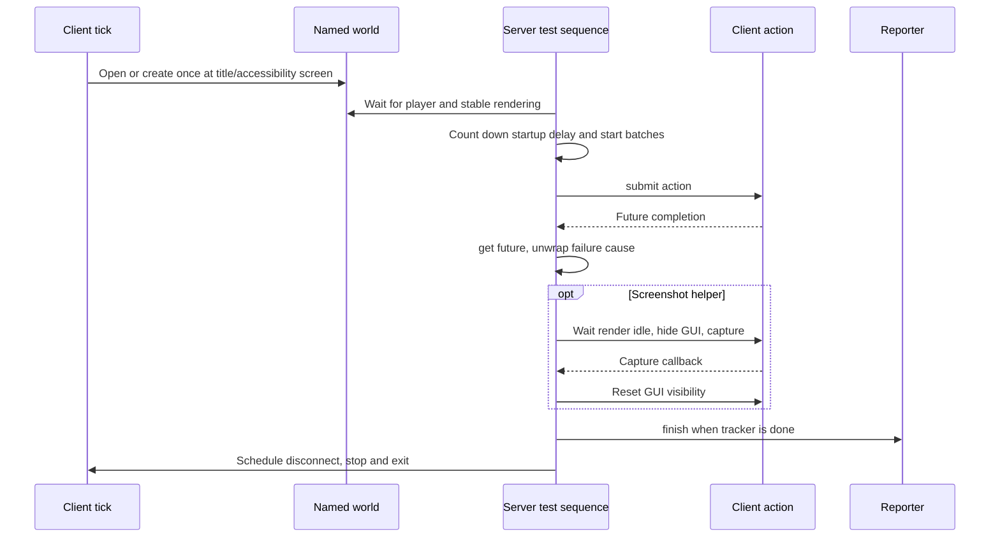
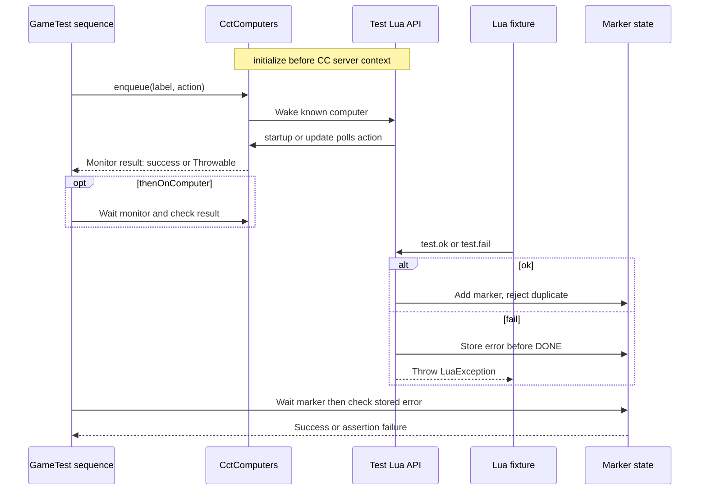

# Testiarium client and ComputerCraft fixtures

[Architecture overview](../architecture/overview.md) · [Harness/features](harness.md#harness-and-feature-model) · [Fresh-report gate](../testing/verification.md#fresh-report-acceptance)

## Target client sequence

This is the [26.1.2 hook](../../projects/testiarium/versions/26.1.2/src/testMod/kotlin/site/siredvin/testiarium/fixture/client/ClientTestHooks.kt#L49-L83), not a universal rendering engine protocol: `onOpenScreen` does not start the world on this target; `onClientTick` waits for the overlay to disappear. [World reuse and start gates](../../projects/testiarium/versions/26.1.2/src/testMod/kotlin/site/siredvin/testiarium/fixture/client/ClientTestHooks.kt#L86-L145) retain an existing named world and count down only once rendering is stable. Exit codes distinguish no tests (1), required failure (2), and completion (0); fresh XML remains mandatory. [thenOnClient and screenshot helpers](../../projects/testiarium/versions/26.1.2/src/testMod/kotlin/site/siredvin/testiarium/fixture/client/ClientTestExtensions.kt#L31-L67) wait for futures/callbacks, not pixel correctness. GUI visibility is reset to false, not restored to an arbitrary previous setting. Old full-file hooks remain version-owned; do not copy private engine descriptors across versions.

## Labeled CCT action and Lua completion

Two completion channels are intentional: [queued action monitor](../../projects/testiarium/versions/26.1.2/src/cctTestMod/kotlin/site/siredvin/testiarium/cct/CctComputers.kt#L37-L82) proves Java action completion; [marker state and API](../../projects/testiarium/versions/26.1.2/src/cctTestMod/kotlin/site/siredvin/testiarium/cct/CctComputers.kt#L126-L185) prove Lua marker/error observation. [thenStartComputer](../../projects/testiarium/versions/26.1.2/src/cctTestMod/kotlin/site/siredvin/testiarium/cct/CctGameTestExtensions.kt#L14-L50) only enqueues; thenOnComputer waits/checks its monitor, while thenLua waits/checks marker state after optional fixture-file validation. Neither enqueue nor DONE alone certifies success. The target API's update polling handles actions queued after startup; the [idle detector](../../projects/testiarium/versions/26.1.2/src/cctTestMod/kotlin/site/siredvin/testiarium/cct/CctComputers.kt#L85-L107) still depends on private ComputerCraft scheduler members. These source diagrams are not newly executed CCT/client tests.

## Current executed capability (2026-10-19)

Focused source checks are in [CctHarnessGameTests](../../projects/testiarium/versions/26.1.2/src/cctTestMod/kotlin/site/siredvin/testiarium/cct/CctHarnessGameTests.kt#L13-L87): queued-after-startup and once-only execution, real Lua completion, and a required outer observer of the optional failure sentinel. Inspected here, not rerun; inherited execution receipts below retain their exact source/date boundary.

[R1](../../docs/verification/minecraft-26-1-R1.md) ports target registry/environment/sequence/CCT scheduler hooks and verifies both loaders with real Lua, client harness XML and screenshots. [R6](../../docs/verification/minecraft-26-1-R6.md) retains full28 native routes; [R7](../../docs/verification/minecraft-26-1-R7.md) adds all six target optional graphical workflows and four old graphical joins. Main/testMod/cctTestMod feature separation remains mandatory. Ordinary Fabric production readiness uses runProductionServer, not Testiarium's standalone runServer.

Use target Testiarium GameTest annotation/registry adapters rather than removed vanilla registration. Headless clients require Xvfb/deadlines and real rendering readiness; title/world/reload/menu/book/equipped-upgrade/real dedicated reconnect receipts are distinct from one harness test. CCT completion/error markers and scheduler-private hooks need real execution after pin changes; avoid one-shot signals that can be discarded while Lua awaits task_complete. No remote CI, online-auth or every UI path is implied by [final acceptance](../../docs/minecraft-26-1-verification.md).

## Historical source notes — October16 baseline

The detailed327f845/e69b721 protocol notes below are retained as background; their unperformed client/CCT statements are historical and superseded within the exact current evidence above.

## Separate optional surfaces

The base [registration harness](harness.md) is main output; client helpers belong to testMod and ComputerCraft integration to cctTestMod. Fabric publishes each as a named feature and includes common fixture output in the corresponding loader JAR. The CCT source set depends on ComputerCraft; normal main output does not acquire that entire test integration automatically.

Fabric runs separate runServer, runCctGameTest and runClientGameTest tasks with distinct report files/directories and common versus client tags. Forge/NeoForge uses runGameTestServer, with -Ptestiarium.cct selecting the optional CCT loaded mod and cct report. Its client run loads base Testiarium plus testMod, not cctTestMod.

## Client world lifecycle

ClientTestHooks is enabled by the presence of testiarium.client. It intercepts the title/accessibility screen once, loads or creates the named testiarium-client flat world, configures low-noise client options, and disables world spawning/daylight/weather changes on creation. Existing named worlds are reused, so this is not a fresh-world guarantee.

The shared 1.20.1 start path waits for an overworld player, sets flying/position/inventory state, waits for stable rendering and a startup delay, then runs registered test batches. It reports progress and finalizes the reporter on completion. Zero tests exit 1, required failures exit 2, otherwise exit 0; shutdown is scheduled onto the client. Client helpers submit actions to the client thread, wait for completion and unwrap ExecutionException causes. Screenshots wait for render idle and a callback before restoring GUI visibility; they are observations, not automatic pixel assertions.

Client hooks and mixins have 1.21.1 full-file overrides; engine-private world/render integration is version-sensitive. Use the owning version path rather than copying old mixin descriptors.

## Labeled ComputerCraft protocol

CctComputers.initialize replaces ServerContext.luaMachine and registers a test Lua API before ComputerCraft creates its server context. Actions are queued per label; enqueue wakes an already-known matching computer. A monitor stores success or the thrown Throwable and check rethrows failures. Reset clears action and marker maps.

The test API records state at computer startup, executes a queued action, and exposes test.ok, test.fail and test.log. A default DONE marker signals completion; duplicate ok for the same marker raises LuaException. fail records an error and DONE, so waiting completes but subsequent checking fails instead of hanging indefinitely.

startup.lua requires a computer label, loads tests/<label>.lua, runs it under pcall and calls test.ok on success. thenLua validates a fixture file when testiarium.cct-fixtures is configured and waits for the label's completion/error state; without that property require performs no file validation. thenOnComputer waits for the Java-action monitor; thenStartComputer only enqueues, so it does not by itself establish successful completion.

CctFixtureCommands imports configured fixture files into world/computercraft/computer/1 and exports them back. Copy replaces existing files and does not delete extra target files. These commands mutate fixture/world files; do not use export as a harmless diagnostic. Labels and disk placement must agree with the fixture computer.

## 1.21.1 scheduling boundary

The CCT version override reflects into ServerContext and ComputerThread to detect a zero queue and all workers idle. Its GameTestServerMixin replaces waitUntilNextTick with task pumping and brief parks until tests have not started or computers are idle. Fabric's 1.21.1 CCT metadata explicitly loads that mixin configuration. This avoids racing tick advancement against asynchronous computers but couples the harness to private ComputerCraft fields/methods; dependency upgrades need real runtime verification.

## Running and interpreting evidence

Headless client tasks require a virtual display and a deadline, for example:

    timeout --foreground 180s xvfb-run --auto-servernum ./gradlew :testiarium:fabric:1.20.1:runClientGameTest --no-daemon
    timeout --foreground 180s xvfb-run --auto-servernum ./gradlew :testiarium:forge:1.20.1:runClientGameTest --no-daemon

Use the exact version node desired; keep logs/screenshots as scratch artifacts. Require a fresh nonempty report, not just process success. See [verification boundaries](../testing/verification.md): no client/CCT runtime or screenshot checks were executed by this documentation run, and the checked-in generic server CI matrix is not a complete CCT/client matrix.
