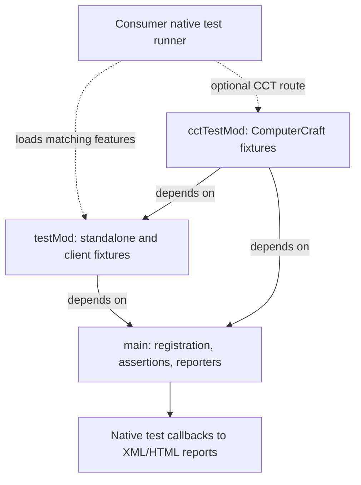
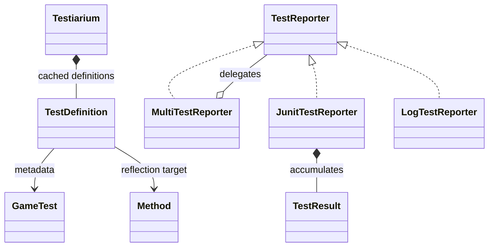
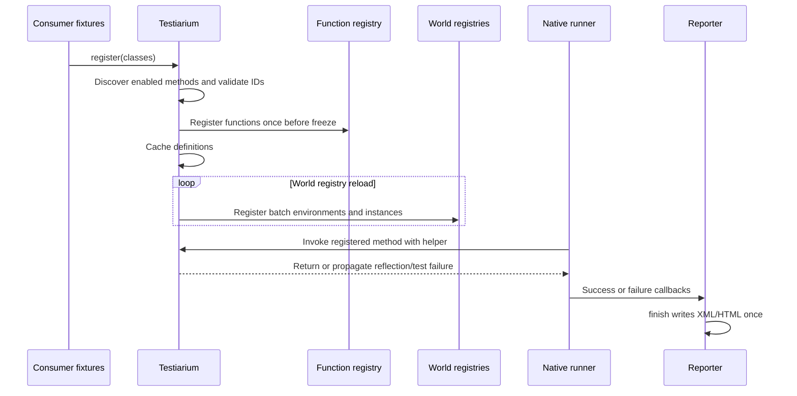

# Testiarium registration and reporting harness

[Architecture overview](../architecture/overview.md) · [Version/loader topology](../architecture/loaders.md)

## Main API versus fixture features

Main owns explicit registration, annotations/assertions and reporters. testMod owns standalone/client fixtures; cctTestMod adds optional CC tooling and depends on testMod. Common uses testiarium-core feature identities; matching loader capabilities/sources stay separate. A compile dependency does not ensure loaded mods, structures or client Mixins are present.

## Harness and feature model

These are feature dependencies, not production Broccolium/Tweakium module dependencies. The [source sets and named features](../../projects/testiarium/build.gradle.kts#L21-L51) and [core/loader capability wiring](../../build.gradle.kts#L112-L148) separate main output from optional fixture JARs. Follow [artifact boundaries](../build/stonecutter-publication.md#main-output-versus-test-features) and [client/CCT behavior](client-cct.md#target-client-sequence) for the next level.

### Focused registration and reporter model

This is a small target ownership model, not every annotation/helper class: [definition caching and invocation](../../projects/testiarium/versions/26.1.2/src/main/kotlin/site/siredvin/testiarium/Testiarium.kt#L33-L69) and [reporter fanout/results](../../projects/testiarium/versions/26.1.2/src/main/kotlin/site/siredvin/testiarium/report/TestReporters.kt#L21-L79) establish its edges. Optional native failure becomes a skipped testcase, not a pass. The report gate separately validates which skips are intended.

### Version-specific registration and execution

The target [discovery](../../projects/testiarium/versions/26.1.2/src/main/kotlin/site/siredvin/testiarium/Testiarium.kt#L63-L99) checks method signatures and normalized method/batch collisions before caching; [instances and invocation](../../projects/testiarium/versions/26.1.2/src/main/kotlin/site/siredvin/testiarium/Testiarium.kt#L101-L147) bind environments and functions, invoking static methods or constructing public no-arg instances. [NeoForge events](../../projects/testiarium/forge/versions/26.1.2/src/main/kotlin/site/siredvin/testiarium/ForgeTestiarium.kt#L13-L25) distinguish static function registration from instance/environment registration. This is not a claim that all reflection failures occur at discovery: constructor invocation can fail during execution. Legacy [1.20.1](../../projects/testiarium/src/main/kotlin/site/siredvin/testiarium/Testiarium.kt#L64-L104) and [1.21.1](../../projects/testiarium/versions/1.21.1/src/main/kotlin/site/siredvin/testiarium/Testiarium.kt#L75-L95) construct native TestFunctions instead of this registry split. After execution, follow the [fresh-report acceptance flow](../testing/verification.md#fresh-report-acceptance).

## Registration across versions

Focused [target RegistrationTests](../../projects/testiarium/versions/26.1.2/src/test/kotlin/site/siredvin/testiarium/RegistrationTests.kt#L32-L118) inspect once-only function registration, fresh reload instances, reflected cause propagation, constructor failures and pre-mutation collision rejection; isolated cleanup restores registration state. These tests were read, not executed for this documentation change.

Old1.20.1/1.21.1 keep their native annotation/loader registration paths. Target26.1.2 uses `site.siredvin.testiarium.api.GameTest` and translates explicit classes to function/instance/environment registries. Collect before the static function registry freezes; instances/environments register per world reload. Methods and batch IDs are normalized and collision-checked. Tags retain method/class/default precedence; unknown enabled methods use loader fallback. Static methods or public no-argument constructors are required; reflection failures are not silent skips.

## Failure/report contract

sequence appends terminal success; raw sequences need their own. Native required outer observers prove fail-fast assertion/exception/assertion-error behavior, one action, blocked later callbacks and competing delayed success. Container assertions reject nonempty expectations beyond capacity, allowing empty padding. Registry test cleanup restores native and private state.

Mapped runs delete old XML, require fresh nonempty non-skip evidence, reconcile testcase counts and reject failures/errors/DOCTYPE. Storage permits no skips. Optional negative fixtures must match exact unique identities and failure sentinels; optional failures are skips, not passes. Reporter finish emits XML/HTML idempotently.

[R1](../../docs/verification/minecraft-26-1-R1.md) verifies target registry/CCT/client capability; [R6](../../docs/verification/minecraft-26-1-R6.md) verifies the full28 native routes,434 cases including38 intended skips and zero storage skips. Final affected replays are separate, not extra unique tests. See [client/CCT](client-cct.md), [verification](../testing/verification.md) and [publication](../build/stonecutter-publication.md).
