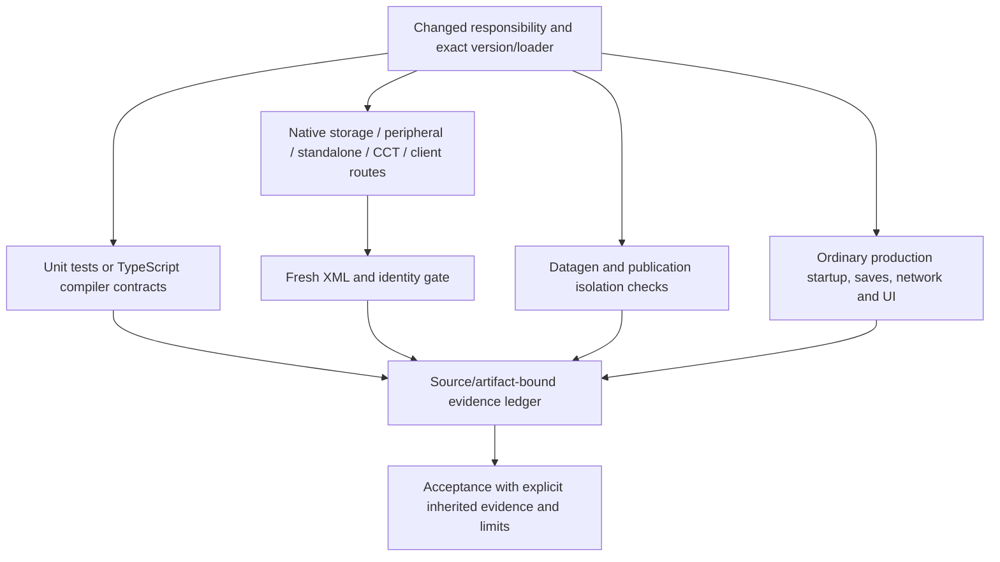
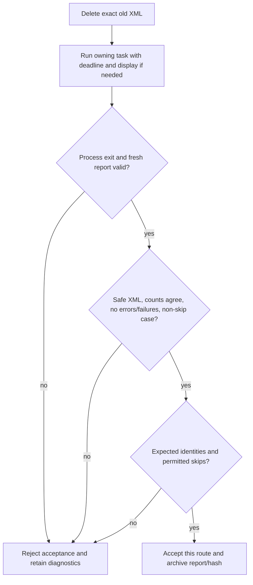

# Verification matrix and evidence boundaries

[Architecture overview](../architecture/overview.md) · [Build/artifact flow](../build/stonecutter-publication.md#source-to-artifact-flow)

## Verification route map

Arrows mean selection and evidence flow, not that every documentation edit launches every gate. [Native matrix routes](../../scripts/verification/run-native-matrix.py#L18-L30) are separate owning tasks, including CCT/client. [Publication checks](../../scripts/check-publications.py#L23-L70) inspect archive properties rather than gameplay; [final acceptance](../../docs/minecraft-26-1-verification.md) records ordinary production/save/network/UI evidence and its limits. This diagram adds no new runtime result. Follow [harness composition](../testiarium/harness.md#harness-and-feature-model) into [client/CCT](../testiarium/client-cct.md#target-client-sequence) when debugging native execution.

## Fresh-report acceptance

The [Gradle guard](../../gradle/gametest-reports.gradle.kts#L20-L48) deletes old XML and rejects DOCTYPE, empty/all-skip results and mismatched counts. The [storage identity gate](../../gradle/gametest-reports.gradle.kts#L47-L87), [negative-fixture sentinel gate](../../gradle/gametest-reports.gradle.kts#L134-L173) and [single client fixture gate](../../gradle/gametest-reports.gradle.kts#L175-L179) are route-specific, not interchangeable. The [matrix runner](../../scripts/verification/run-native-matrix.py#L33-L62) additionally checks report modification time, duplicate names and byte hashes; [process acceptance](../../scripts/verification/run-native-matrix.py#L79-L109) requires zero exit and fresh client screenshot where applicable. The diagram combines these real layers, not a claim that one parser alone performs every check. Optional negative fixtures remain skips and must fail for their exact intended reason; an interrupted process never becomes a pass by leaving XML behind.

## Choose exact owning checks

Use versioned wrapper paths and --no-daemon, scratch stdout/stderr logs and explicit deadlines. Shared changes need the maintained matrix; JUnit does not replace native GameTests or ordinary production startup. `scripts/verification/run-native-matrix.py` defines28 concrete routes, including separate CCT/client runs. Headless clients use Xvfb. Canonical1.20.1 restoration is a checked source contract.

Mapped GameTests delete the exact old XML before launch and require fresh nonempty testcase counts, at least one non-skipped case, no failure/error and exact negative-fixture identities/sentinels. Storage skips are forbidden. Zero process exit, stale XML and interrupted processes are not acceptance.

## Verified campaigns, without double-counting

- R5 baseline: three actual active-state root builds, each1,734 units/108 XML/19 nodes,36 publications/118 artifacts; two datagen passes across all six loader/version pairs,40 actual tasks/96 selected production JSON resources. Actual old Kotlin consumers prove metadata/runtime isolation.
- R6 assembled baseline:1,753 units/109 XML,28 native routes434 cases =396 passes +38 exact intentional negative skips;99 storage cases with zero skips. Six ordinary production routes/restarts and20 copied/staged-save semantic executions preserve originals/backups.
- Final R7 candidate:1,757 units/110 XML/19 nodes; affected8 native routes78 cases, zero failure/error/skip;9 external consumers,36 publications/72 all-variant viewer isolation files;24 target datagen tasks/two passes. Twelve accepted ordinary lifecycle runs,12 copied-save opens/restarts,4 old graphical joins and both complete12-phase actual-two-client network replays refresh affected artifacts.
- Six target optional graphical workflows retain90 original PNGs,192 positive submissions and24 Filler checkpoints. These are exact-source reused lane executions, not new launches in F's documentation audit.

[Final verification](../../docs/minecraft-26-1-verification.md), [coverage](../../docs/module-test-coverage.md), [R5](../../docs/verification/minecraft-26-1-R5.md), [R6](../../docs/verification/minecraft-26-1-R6.md) and [R7 final integration](../../docs/verification/minecraft-26-1-R7-final-integration.md) provide exact commands/ledgers/hash bindings. Do not sum overlapping campaigns as unique coverage or recursively count obsolete XML trees.

## Retained limits and failures

Old NeoForge1.21.1 shutdown143 is retained; unchanged retry/restart passes, not a repair. Legacy Filler appearance and two source-ZIP order limits remain. No arbitrary provider/protection/render geometry, online-auth, recipe-transfer, cross-loader conversion, downgrade or cross-version wire/ABI certification. The inherited npm advisory/strict-null limitation remains; its triage was dropped, not fixed or revived. Local execution is not remote CI/publication/release; local Obsidian save is not proven cross-device sync.

Final local closure is documented in the [delivery index](../../docs/verification/minecraft-26-1-delivery.md): all204 requirement identities/owners remain, with197 inherited/local evidence dispositions and7 final-documentation dispositions, not204 runnable test passes. Current1128 source hashes and118 exported JAR bytes are independently checked. Historical raw sibling runtime ZIP paths were removed, so original campaign audits are inherited accepted receipts rather than freshly replayable or implicitly bundled evidence. The stable source snapshot is committed before deterministic generated-wiki metadata; only openwiki files may differ afterwards.

See [build](../build/stonecutter-publication.md), [Testiarium](../testiarium/harness.md) and [client/CCT](../testiarium/client-cct.md).
