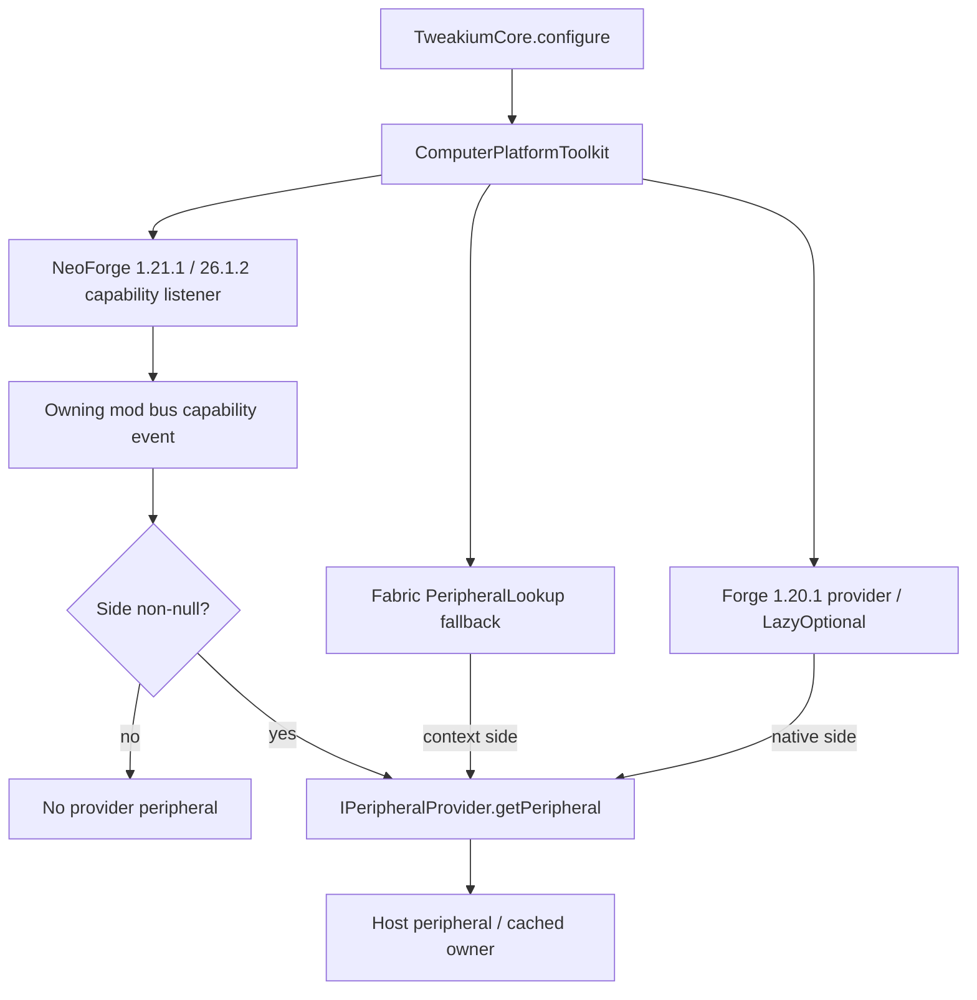
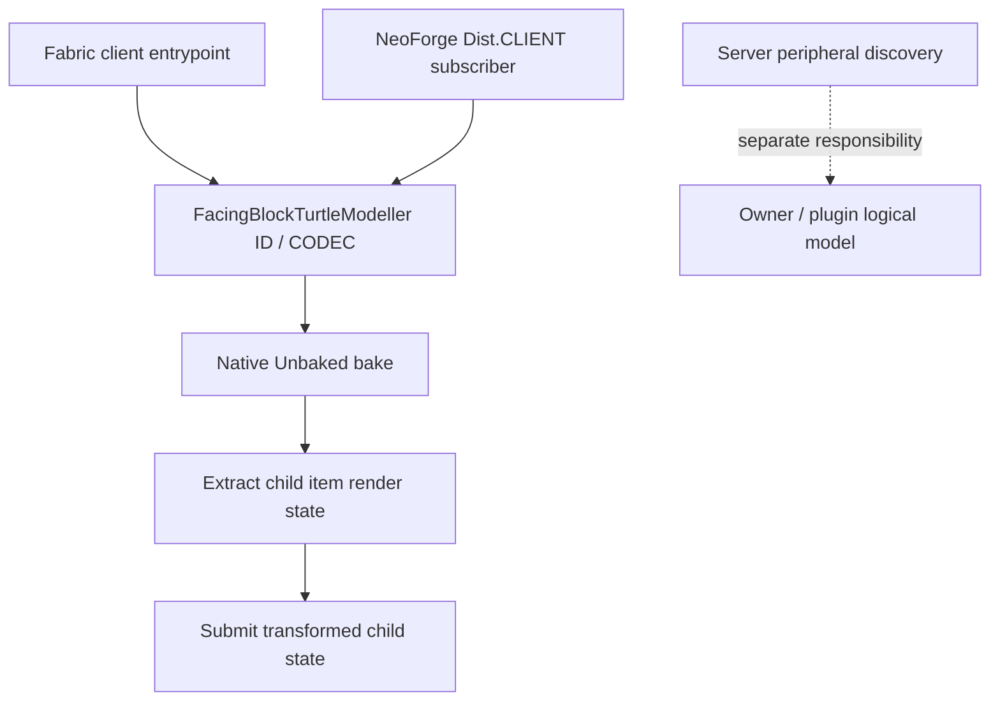

# Tweakium ComputerCraft loader boundaries

[Architecture overview](../../architecture/overview.md) · [Peripheral composition/dispatch](../modules/peripheral.md) · [Version/loader topology](../../architecture/loaders.md)

## Logical discovery adapters

Arrows below mean registration or delegation, not inheritance. Every branch ends at the common provider interface; none grants player permissions. One-time guards prevent duplicate registration, not late-registration repair.

Source: [common configuration](../../../projects/tweakium/src/main/kotlin/site/siredvin/tweakium/TweakiumCore.kt#L17-L27), [target Fabric fallback](../../../projects/tweakium/fabric/versions/26.1.2/src/main/kotlin/site/siredvin/tweakium/modules/platform/FabricComputerPlatformToolkit.kt#L49-L54), [target NeoForge bus/type/side boundary](../../../projects/tweakium/forge/versions/26.1.2/src/main/kotlin/site/siredvin/tweakium/modules/platform/ForgeComputerPlatformToolkit.kt#L56-L66). The modern direct lookup first checks the native capability then generic CC fallback ([lines 39–40](../../../projects/tweakium/forge/versions/26.1.2/src/main/kotlin/site/siredvin/tweakium/modules/platform/ForgeComputerPlatformToolkit.kt#L39-L40)); the diagram is the registered provider path, not every CC fallback. Old loader details remain below.

## Physically client-only model registration

The [Fabric client initializer](../../../projects/tweakium/fabric/versions/26.1.2/src/main/kotlin/site/siredvin/tweakium/modules/client/FabricTweakiumClient.kt#L7-L10) is declared in the [client entrypoint field](../../../projects/tweakium/fabric/versions/26.1.2/src/main/resources/fabric.mod.json#L12-L16); [NeoForge's subscriber](../../../projects/tweakium/forge/versions/26.1.2/src/main/kotlin/site/siredvin/tweakium/modules/client/ForgeTweakiumClient.kt#L10-L15) is client gated. The [render-state pipeline](../modules/representation-rml.md) is not a server class-ownership diagram. Do not transplant these 26.1.2 codecs into the older modeller APIs.

## Current target adapters and integration policy (2026-10-19)

Exact26.1.2 Fabric/NeoForge adapters preserve common service ownership, UpgradeType/template factories and physically isolated client codecs/models. NeoForge capability listeners attach to the owning mod bus; actual final native/Lua/dedicated/client executions prove discovery, not mere compilation. Old1.20.1 Forge/Fabric and1.21.1 NeoForge/Fabric APIs stay version-specific. [R3](../../../docs/verification/minecraft-26-1-R3.md) and [R7 target](../../../docs/verification/minecraft-26-1-R7-target.md) own the implementation evidence.

The approved viewer policy removes active REI dependencies on all lines: EMI1.1.24 on old versions; JEI29.47.0.111 on both target loaders; optional target Fabric ModMenu18.0.2. No incompatible old EMI or missing upstream REI entrypoint was force-loaded/suppressed. Config-port26.1.5 is conditional N/A because actual source has no consumer; Night Config transitives remain. Viewers/private client fixtures are excluded from all main/public runtime metadata. [Final integration](../../../docs/verification/minecraft-26-1-R7-final-integration.md) binds production/source/consumer/packet evidence after the owning-event-bus fix.

## Historical source notes — October16 baseline

The details below describe327f845/e69b721 old loader behavior; current26.1.2 overrides, target lifecycle and runtime acceptance above take precedence. Do not import legacy capability APIs into the target.

## Bootstrap and service ownership

TweakiumCore.configure installs ComputerPlatformToolkit and the mod's TweakiumPlatform, adds a Broccolium block energy callback wrapping turtle fuel, and registers generic peripheral discovery. FabricTweakium configures services during object initialization and forces FabricBroccolium before common content registration in onInitialize. ForgeTweakium configures services and common registrations, then attaches deferred block/item/block-entity registries to the KotlinForForge bus. Its sayHi forces Broccolium initialization when invoked by dependents.

The 1.21.1 NeoForge override additionally attaches data-component, pocket/turtle UpgradeType and criterion-trigger registers. Names still say Forge, but imports, event bus, capabilities and upgrade APIs are NeoForge/current-version specific. Do not move these calls into common code.

## Discovering a peripheral

Common block entities expose IPeripheralProvider.getPeripheral(side); adapters bridge it to ComputerCraft:

- Fabric registers a PeripheralLookup fallback once. If its supplied block entity implements IPeripheralProvider, it forwards the context side; otherwise it returns null. Direct getPeripheral uses PeripheralLookup.find.
- Legacy Forge registers a ForgeComputerCraftAPI provider once, resolves the block entity and returns its peripheral inside LazyOptional or empty. Direct lookup uses ComputerCraft's Peripherals helper.
- NeoForge 1.21.1 installs a RegisterCapabilitiesEvent listener once and registers a peripheral capability factory for each block-entity type present when the event runs. It only forwards IPeripheralProvider when side is non-null. Direct lookup first queries PeripheralCapability and then asks for a generic peripheral.

Registering the listener too late or forgetting the owning loaded mod is not repaired by a Kotlin interface alone. Null-side behavior is also not identical across these implementations.

## Upgrade and fake-player API boundary

Fabric 1.20.1 registers TurtleUpgradeSerialiser/PocketUpgradeSerialiser into ComputerCraft registries obtained from BuiltInRegistries; missing registries throw IllegalStateException. Its 1.21.1 override registers UpgradeType values instead. The NeoForge toolkit's upgrade resolution accepts HolderLookup.Provider and creates upgraded item stacks using CC data components. Treat it as a public API/version boundary, not a loader import substitution. [Registration and providers](../modules/platform-data.md) and [upgrade persistence](../modules/upgrades-persistence.md) trace the shared consumers.

Fake-player construction routes through the toolkit. FabricFakePlayer specializes Fabric's FakePlayer, restores the current player's advancement player binding when one exists, ignores die, allows player harm and uses custom eye/attack-strength behavior. Legacy ForgeFakePlayer specializes Forge's class, disables menu opening and riding, and also changes eye/attack-strength behavior. Host identity and inventory preparation are owned by [player providers](../modules/player.md), not by peripheral lookup.

## Energy and test isolation

The legacy ForgeEnergyPlugin is a small IEnergyStorage reader: Lua methods getEnergy/getEnergyCapacity return Int and getEnergyUnit returns FE; all are main-thread methods. It is not the generic transferable [energy plugin](../modules/plugins.md) or proof of every 1.21.1 backend's API shape.

Loader test-mod source sets and loaded-mod declarations live in build scripts separately from production entrypoints. The [verification guide](../../testing/verification.md) covers the native NeoForge inventory regression and Lua fixture runs. No loader startup or application tests were run for this wiki.
