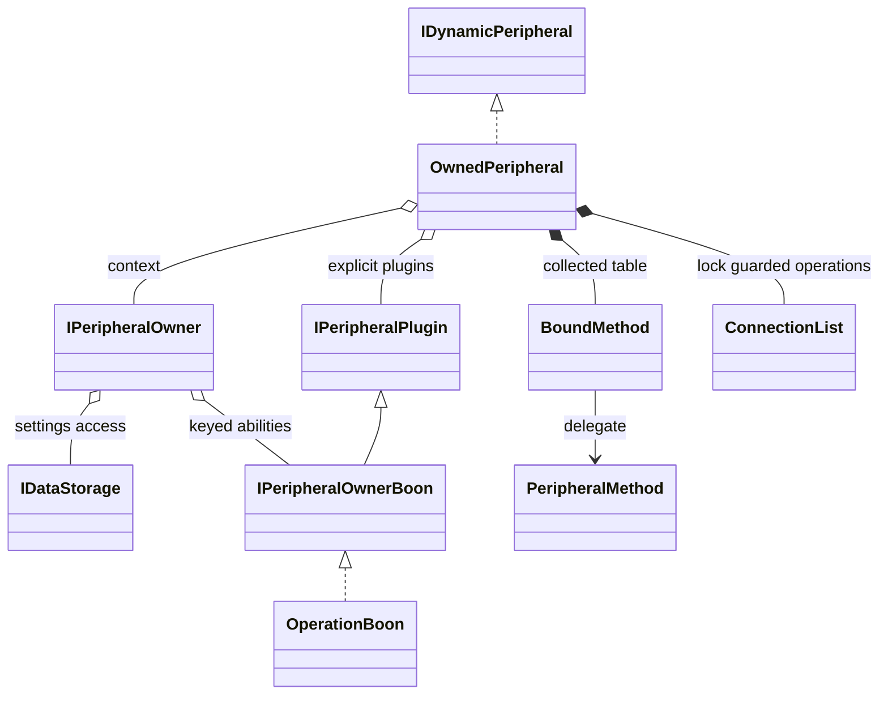
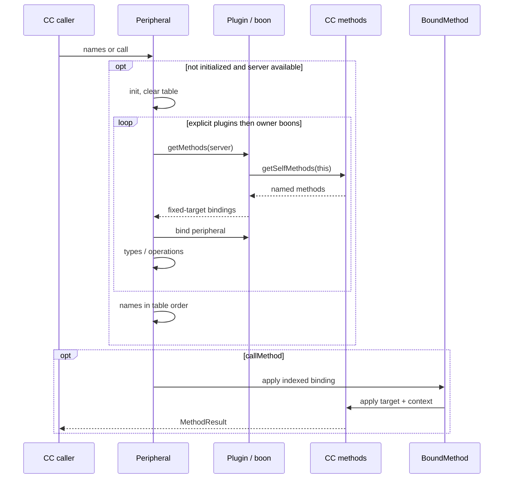
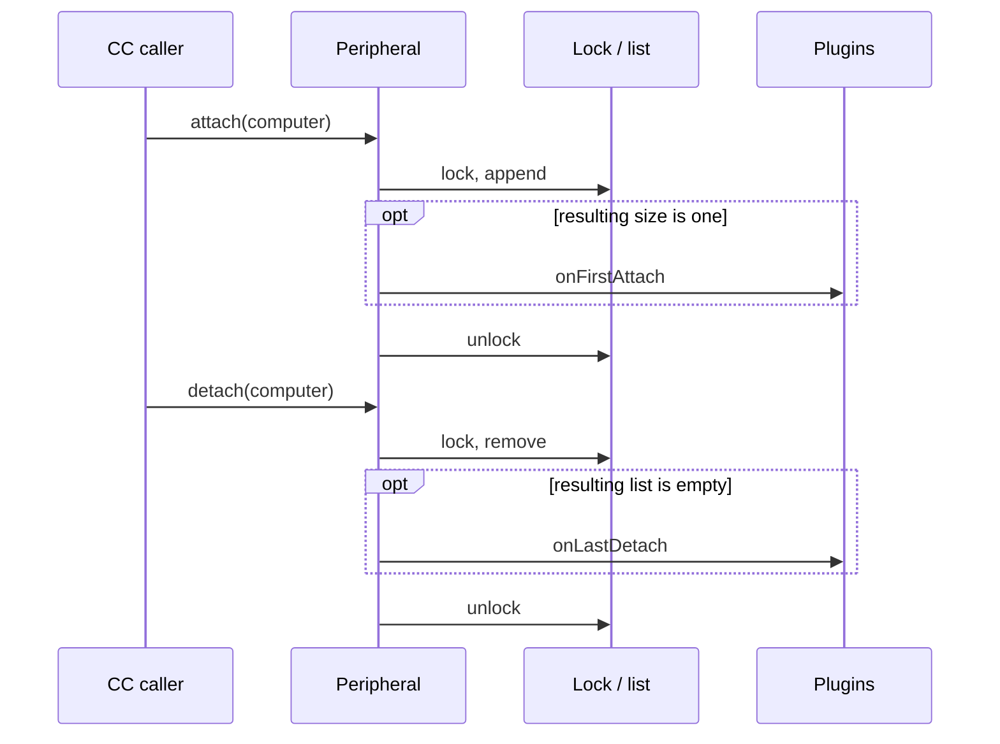

# Tweakium peripheral dispatch and ownership

[Architecture overview](../../architecture/overview.md) · [Version/loader topology](../../architecture/loaders.md)

## Current maintained-version contract (2026-10-19)

The owner/plugin/boon separation remains: a fake player or owner object is not permission by itself. Install plugins before lazy CC method collection; late additions do not automatically rebuild dispatch. Settings retain peripheralData/ownerProfile and target ValueInput/ValueOutput adapts world hooks without changing ownership. Item transport, world data and client sync remain separate.

[R3](../../../docs/verification/minecraft-26-1-R3.md) now supplies actual Lua binding/query/transfer/refusal and live owner/session/upgrade proof, modern storage parity and deterministic data. [R6](../../../docs/verification/minecraft-26-1-R6.md) adds copied-save/process/network scenarios; [R7 final integration](../../../docs/verification/minecraft-26-1-R7-final-integration.md) refreshes affected Lua/consumer/artifact evidence. Encode failure does not write/notify, explicit component removals survive reconstruction, and operations do not promise callback rollback. See [final limits](../../../docs/minecraft-26-1-verification.md).

## Historical source notes — October16 baseline

The detailed notes below preserve the earlier327f845/e69b721 source snapshot and its then-unperformed tests. They are historical, not a current statement that the later R0–R7 runtime work is unperformed. Current full-file26.1.2 overrides and acceptance above take precedence.

## Composition model

Hollow triangles mean implementation/extension, diamonds mark held references (filled = internally collected state), and an ordinary arrow means delegation. `ConnectionList` is a diagram label for the internal list, not a new Kotlin class. Owner boons are plugin-like but their map iteration order is not a stable registration order. The explicit plugin list is ordered. Sources: [OwnedPeripheral fields and collection](../../../projects/tweakium/src/main/kotlin/site/siredvin/tweakium/modules/peripheral/OwnedPeripheral.kt#L19-L100), [owner services](../../../projects/tweakium/src/main/kotlin/site/siredvin/tweakium/modules/peripheral/api/IPeripheralOwner.kt#L19-L54), [keyed owner map](../../../projects/tweakium/src/main/kotlin/site/siredvin/tweakium/modules/peripheral/owner/BasePeripheralOwner.kt#L10-L33), [boon interface](../../../projects/tweakium/src/main/kotlin/site/siredvin/tweakium/modules/peripheral/api/IPeripheralOwnerBoon.kt#L3-L4). Drill down to [plugin/operation policy](plugins.md), [fake-player sessions](player.md), [platform/data](platform-data.md), [representation versus client models](representation-rml.md) and [upgrade persistence](upgrades-persistence.md).

OwnedPeripheral combines ComputerCraft IDynamicPeripheral with an IPeripheralOwner. The peripheral owns type, plugin list, bound method table, additional types and computer connections. The owner supplies world/position/facing, player identity, storage, persistence and host-specific actions. An owner is a context/capability object, not automatically an access-control policy.

BasePeripheralOwner keeps typed boons keyed by IPeripheralOwnerBoonKey and rejects duplicate keys. attachOperations installs OperationBoon. IPeripheralOwner.withOperation requires that boon and throws if absent; merely declaring an operation on a plugin does not create it. See [operations and plugins](plugins.md).

## Lua dispatch lifecycle

No Tweakium thread hop occurs in [callMethod](../../../projects/tweakium/src/main/kotlin/site/siredvin/tweakium/modules/peripheral/OwnedPeripheral.kt#L137-L160) or [BoundMethod](../../../projects/tweakium/src/main/kotlin/site/siredvin/tweakium/modules/peripheral/BoundMethod.kt#L11-L18). [Plugin discovery](../../../projects/tweakium/src/main/kotlin/site/siredvin/tweakium/modules/peripheral/api/IPeripheralPlugin.kt#L7-L17) delegates CC's machinery; concrete storage methods declare main-thread work rather than this wrapper scheduling every method. If no server is available, the build is skipped; bad/unbuilt indices can fail. Collection sets `initialized` before callbacks, so an exception leaves partially initialized state rather than automatically retrying. Late plugins only append/update types, not rebuild the table ([collection](../../../projects/tweakium/src/main/kotlin/site/siredvin/tweakium/modules/peripheral/OwnedPeripheral.kt#L65-L100)).

IPeripheralPlugin.getMethods asks ComputerCraft ServerContext's method registry for that plugin's methods and wraps each in BoundMethod with a fixed target. BoundMethod.apply forwards target, Lua context, computer access and arguments to the CC method implementation. The framework therefore relies on ComputerCraft's method machinery, including annotations, instead of providing a separate reflection engine.

OwnedPeripheral builds lazily from getMethodNames or callMethod only when PlatformToolkit has a Minecraft server. It clears collected methods/types, visits explicit plugins and then owner boons, binds each to the peripheral, collects operations into an existing OperationBoon, and stores the method-name array in the same order as the bound list. Calls dispatch directly by index into that list.

Add plugins and boons before the first build. addPlugin appends and updates additional types but does not invalidate the initialized method table; late additions need deliberate rebuilding by an extension rather than assuming automatic hot-plug dispatch. initialized is set before collection, so a collection exception is not automatically retried. Calling without server initialization or with a bad method index is not turned into a friendly validation result by this class.

## Connection/configuration behavior

Callbacks run on the invoking thread under the lock, without an explicit main-thread scheduler. An exception releases the lock but does not undo the list mutation or earlier callbacks. Attach does not deduplicate; detach on an already empty list still satisfies `isEmpty`, so repeated/unmatched detach can invoke `onLastDetach` again. These details follow [the actual methods](../../../projects/tweakium/src/main/kotlin/site/siredvin/tweakium/modules/peripheral/OwnedPeripheral.kt#L103-L134), not a stronger imagined connection state machine.

attach and detach mutate the computer list under ReentrantLock and invoke explicit plugin onFirstAttach/onLastDetach when the resulting list has one/zero connections, respectively. These callbacks do not iterate owner boons, unlike method collection. forEachComputer and presence/count queries lock, but connectedComputers returns the underlying list as a List, not a snapshot. Avoid assuming that every access path has immutable/snapshot isolation.

configuration constructs a fresh map, optionally writes implementationProvider, then lets boons and plugins contribute in that order; later contributions can overwrite keys. Equality compares type, owner and plugin class sets, not individual plugin state. This is not an identity or authorization check for every Lua call.

## Block-host state

PeripheralBlockEntity lazily constructs and caches a single peripheral from the first requested side. Subsequent requests reuse it; a subclass needing distinct per-side peripherals must override the behavior. It stores peripheralSettings and optional owner UUID in world NBT as peripheralData and ownerProfile. markSettingsChanged only marks dirty.

StatefulPeripheralBlockEntity adds item-save/load support by copying settings keys into/out of supplied NBT; load merges keys rather than clearing absent old settings, and this item payload does not automatically carry the base entity's owner UUID. MutablePeripheralBlockEntity adds internal-data world/update-tag hooks, packet generation and server block update notification, separately from the settings dirty marker. Persistence signatures have 1.21.1 overrides using registry providers; consult the effective file when extending them.

World persistence, item round-trip and client synchronization are distinct paths. See [Broccolium block lifecycle](../../broccolium/modules/platform-base.md), [upgrade persistence](upgrades-persistence.md), [player contexts](player.md) and [loader lookup](../integrations/loaders.md). No live attachment/save/reload or dynamic late-plugin tests were executed during this wiki run.
