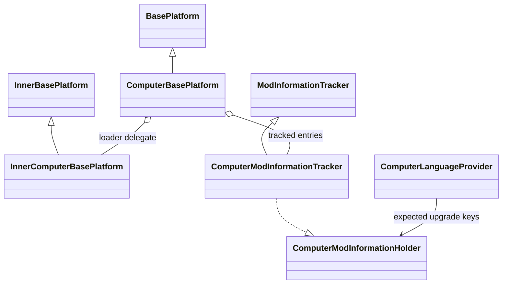
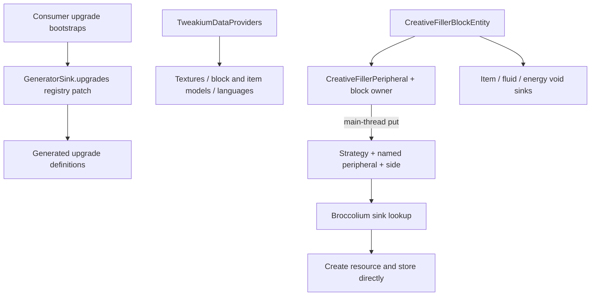

# Tweakium registration, data and creative filler

[Architecture overview](../../architecture/overview.md) · [Peripheral module map](peripheral.md) · [Broccolium data boundary](../../broccolium/modules/data.md)

## Platform and definition composition

Triangles mean extension/implementation, diamonds held references, and arrows data consumption. [26.1.2 registration](../../../projects/tweakium/versions/26.1.2/src/main/kotlin/site/siredvin/tweakium/modules/platform/ComputerBasePlatform.kt#L17-L49) tracks keyed UpgradeType entries and delegates native registration. Target custom-item factories operate on `ItemStackTemplate`; the old serializer and 1.21.1 type differences are spelled out below. The holder/tracker is a datagen input, not the player's settings store.

Solid arrows are production/data flow; disconnected build and runtime branches are deliberate. [UpgradeDataProviders](../../../projects/tweakium/versions/26.1.2/src/main/kotlin/site/siredvin/tweakium/modules/data/UpgradeDataProviders.kt#L9-L21) installs registry patches, whereas [TweakiumDataProviders](../../../projects/tweakium/versions/26.1.2/src/main/kotlin/site/siredvin/tweakium/modules/data/TweakiumDataProviders.kt#L20-L40) generates the shipped Filler assets. Old versions have abstract utilities but no corresponding concrete Tweakium production generator. The common [Filler entity](../../../projects/tweakium/src/main/kotlin/site/siredvin/tweakium/modules/minecraft/blockentity/CreativeFillerBlockEntity.kt#L22-L40) supplies destructive sinks, not buffers. The target [put implementation](../../../projects/tweakium/versions/26.1.2/src/main/kotlin/site/siredvin/tweakium/modules/minecraft/computercraft/CreativeFillerPeripheral.kt#L38-L79) throws on missing target/type/id, does not transfer from inventory, and discards the store remainder. It is not an operation-fuel or permission check. See [operations](plugins.md) and [upgrade transport](upgrades-persistence.md) for those distinct seams.

## Target registration and generated content (2026-10-19)

Target26.1.2 keeps keyed UpgradeType registration and immutable ItemStackTemplate definitions resolved with registry/world context; runtime inventory values remain ItemStack. Upgrade registry patches and language validation use the owning tracker; actual loader registration is distinct from data generation. [R3](../../../docs/verification/minecraft-26-1-R3.md) supplies native/live upgrade and deterministic provider proof.

The user-approved target Creative Filler toxic-purple barrel is generated by TweakiumDataProviders/CreativeFillerTextures, not hand-edited output. Legacy checkerboard remains unchanged. Filler is a creative resource producer with destructive void sinks, not a persistent production tank/energy store or permission system. The stronger real Lua fixture checks item result/error schemas on maintained loaders; [R7 final integration](../../../docs/verification/minecraft-26-1-R7-final-integration.md) replays target data/publication/native/UI/process gates. Six target workflows include24 positive Filler render checkpoints. No recipe-transfer or arbitrary geometry/protection certification follows.

## Historical source notes — October16 baseline

The details below preserve327f845/e69b721 and then-unperformed coverage. Current26.1.2 overrides, stronger Lua fixtures and generated-resource acceptance above supersede those limitations where explicitly verified.

## Computer-specific registration façade

ComputerBasePlatform extends Broccolium BasePlatform and owns a ComputerModInformationTracker. In 1.20.1 it registers turtle/pocket serializers through InnerComputerBasePlatform and records their suppliers in the tracker. ComputerLanguageProvider derives expected adjective keys from those serializer IDs in addition to base block/item/stat/text keys. Consumer registration and language validation are connected; bypassing tracking can hide omissions from that validation.

The 1.21.1 full-file override registers UpgradeType and returns keyed RegistryEntry values. Custom-item helpers create types whose codec encodes an item and constructs the upgrade with its own type reference, or use reduced factories with UpgradeType.simpleWithCustomItem. IDs and factories are meaningful extension contracts, not interchangeable serializers. ComputerLanguageProvider now reads keyed tracked upgrade entries directly.

## Upgrade data flow across versions

The 1.20.1 LibPocketUpgradeDataProvider collects serializers touched by registerUpgrades, passes each generated definition to CC's provider, and rejects expected serializers with no default item definition. That catches missing definitions, not arbitrary gameplay correctness. Turtle provider is the sibling seam; use effective version-specific source before extending it.

In 1.21.1 GeneratorSink.upgrades instead installs a registry patch over IPocketUpgrade.REGISTRY and ITurtleUpgrade.REGISTRY with supplied bootstrap functions. Registry-aware data flows through [Broccolium sinks](../../broccolium/modules/data.md). Runtime loader registration of UpgradeType remains a distinct step from generating data-defined upgrades. See [upgrade lifecycle](upgrades-persistence.md) and [loader adapters](../integrations/loaders.md).

## Shipped creative-filler path

CommonHooks.onRegister forces TweakiumBlocks and TweakiumBlockEntityTypes initialization. creative_filler is a nonticking GenericBlockEntityBlock; its entity lazily creates CreativeFillerPeripheral with a BlockEntityPeripheralOwner. The same entity exposes item/fluid/energy void sinks, so inserting resources into it is deliberately destructive rather than persistent storage.

CreativeFillerPeripheral has type creative_filler and is always enabled. Its main-thread put(mode,target,id,limit=64) chooses item/fluid/energy strategy, resolves a named available peripheral, derives a side when ISidedPeripheral is present, and asks Broccolium's sink lookup to adapt the target. It resolves the item/fluid/energy ID, constructs the resource and stores it directly. It does not transfer from an existing source, return an accepted amount or retain a remainder. Item quantities are upper-clamped to the item stack limit; this path does not share plugins' general nonnegative argument validator. Missing target/sink/resource and invalid mode raise errors.

The 1.21.1 implementation uses ResourceLocation.parse and ItemStack construction with defaultMaxStackSize rather than the shared legacy constructors. Creation is a privileged creative/testing-style capability; the implementation itself does not add a per-call player ownership permission check merely because the peripheral has an owner.

## Tests and changes

The Lua fixture finds creative_filler and a barrel, requires it empty, creates one stone, verifies exactly slot 1 with one stone, then checks invalid mode, missing target, wrong target-argument type and missing item failures. Its GameTest waits for Lua completion using Testiarium. This is concrete item-path coverage, not fluid/energy/negative-limit/world-reload coverage. No fixture was run for wiki creation.

When extending the public surface, update the owning Kotlin API, datagen/language inputs, [typed client contracts](../../typed-peripheral-api/contracts.md) where relevant, and focused fixtures together. Do not manually edit generated resources.
