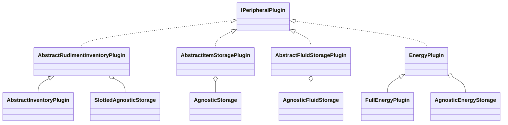
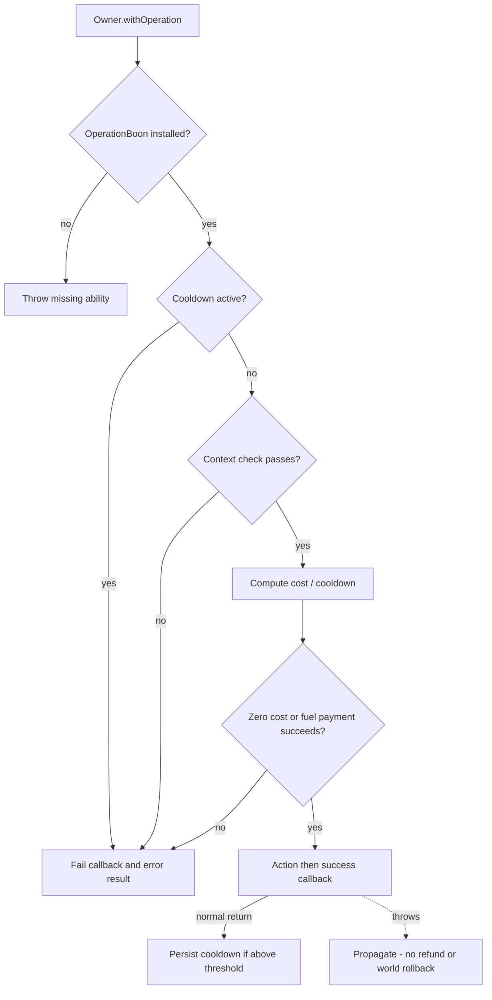

# Tweakium storage plugins and operations

[Architecture overview](../../architecture/overview.md) · [Peripheral composition](peripheral.md) · [Broccolium transfer sequence](../../broccolium/modules/storage.md#generic-transfer-sequence)

## Small plugin family model

Triangles mean implementation/extension; diamonds mean storage references, not native-container ownership. In particular `AbstractInventoryPlugin` does not inherit from the unslotted item plugin. [Inventory view](../../../projects/tweakium/src/main/kotlin/site/siredvin/tweakium/modules/plugins/AbstractRudimentInventoryPlugin.kt#L14-L36), [transfer extension](../../../projects/tweakium/src/main/kotlin/site/siredvin/tweakium/modules/plugins/AbstractInventoryPlugin.kt#L17-L89), [item plugin](../../../projects/tweakium/src/main/kotlin/site/siredvin/tweakium/modules/plugins/AbstractItemStoragePlugin.kt#L22-L39) and [energy extension](../../../projects/tweakium/src/main/kotlin/site/siredvin/tweakium/modules/plugins/FullEnergyPlugin.kt#L14-L44) show composition and main-thread Lua annotations. A named peripheral's target/optional side goes through Broccolium lookup before movement. Missing/incompatible peers raise Lua errors; numeric versus predicate slots follow different validation paths, not a single universal coercion.

## Boons and operation policy

The owner holds keyed boons; `OperationBoon` retains the owner and an allowed-operation map, and consults the separately installed `FuelBoon`. That map supplies public configuration; duplicate settings names replace earlier entries, not a second execution-policy registry. [Owner entry](../../../projects/tweakium/src/main/kotlin/site/siredvin/tweakium/modules/peripheral/api/IPeripheralOwner.kt#L43-L54), [canonical operation ordering](../../../projects/tweakium/src/main/kotlin/site/siredvin/tweakium/modules/peripheral/boon/OperationBoon.kt#L39-L96) and [target equivalent](../../../projects/tweakium/versions/26.1.2/src/main/kotlin/site/siredvin/tweakium/modules/peripheral/boon/OperationBoon.kt#L39-L91) ground the flow. Checks/payment/action run synchronously on the calling path: the concrete Lua method, not the policy object, owns any main-thread declaration. [Operation tests](../../../projects/tweakium/src/test/kotlin/site/siredvin/tweakium/OperationBoonTests.kt#L47-L159) exercise refusal/payment/cooldown order, inspected but not rerun here. See [dispatch](peripheral.md#lua-dispatch-lifecycle) and [persistence](upgrades-persistence.md) for the surrounding lifecycle.

## Current validation and runtime proof (2026-10-19)

Maintained query repairs reject unknown/null operations and malformed/empty logical tables rather than silently broadening filters. Target fluid limits reject negative/nonfinite amounts before mutation and use validated registry IDs. Inventory numeric/query destination conversion and conservation remain owning contracts, not evidence of one global validator. Lua/TypeScript number does not erase Long/Double narrowing or fractional-unit limits.

[R3](../../../docs/verification/minecraft-26-1-R3.md) retains behavioral reds/greens and actual native item/fluid/energy/plugin Lua transfer/refusal/payment cases. [R7 integration](../../../docs/verification/minecraft-26-1-R7-final-integration.md) strengthens real Lua fill/error correlation and refreshes final sources/artifacts. OperationBoon still sequences context/cooldown, fuel payment, action/callback and final cooldown write; callback failure does not automatically refund fuel or undo world state. Reverse storage requires native/exact-replacement support; arbitrary external providers are not transactional by inference. See [final limits](../../../docs/minecraft-26-1-verification.md).

## Historical source notes — October16 baseline

The following327f845/e69b721 snapshot retains prior inspection findings; unknown-field ignoring and empty-reducer observations were inputs to later regression fixes, not current query contracts. Current effective source and evidence above take precedence.

## Lua request to storage transfer

Storage plugins expose main-thread Lua methods and additional ComputerCraft types. A typical call resolves computer.getAvailablePeripheral(name), obtains its target and optional ISidedPeripheral.side, adapts it through Broccolium storage/sink lookup, caps the requested amount and invokes moveTo/moveFrom. Missing peripheral or incompatible target becomes LuaException. Generic lookup can still throw for an unsupported target object; it is not a universal container coercion layer.

AbstractItemStoragePlugin handles unslotted item queries and compact/detailed listing through LuaRepresentation. AbstractInventoryPlugin adds slotted transfer and advertises inventory/inventory_extended plus inventoryTransferLimit and inventoryAPI=[1,1]. Fluid plugins advertise fluid_storage/fluid_storage_extended, tank contents/capacities and fluidStorageAPIVersion=[1,2]. These configuration keys are exact wire contracts, not an automatically enforced version negotiation protocol.

## Validation is caller-specific

Inventory pushItems resolves target before checking a nonpositive limit, returns zero for such limits, validates explicit destination slots against a slotted sink, and converts Lua one-based numeric source/destination slots to zero-based indices. A nonnumeric source argument becomes an item predicate.

pullItems validates an explicit destination against the receiving storage before either numeric or query movement. The numeric branch additionally requires slotted source storage and validates its source range. Both paths forward the converted zero-based destination; the query branch names toSlot explicitly. Native tests demonstrate query-pull limit/destination/conservation and numeric invalid-destination refusal without mutation. Generic backend guarantees still belong to Broccolium rather than this Lua validation layer.

Unslotted item, fluid and full energy transfers upper-cap limits but do not share the inventory method's explicit nonpositive short-circuit. There is no single global nonnegative/finite limit validator at this layer. Downstream storage behavior is part of the result, especially for negative, nonfinite or conversion-edge values.

Item predicates accept null as match-all, a string registry ID, or maps of composable operations. Recognized fields aggregate with AND; unknown fields and null values are ignored. OR/AND/NONE builders filter child values to maps and reduce without an empty identity, so an empty effective child collection can fail. This is a separate map-query language from [RML](representation-rml.md), not JSON-schema validation.

## Units and representation pitfalls

Fluid transfer calls cap with fluidStorageTransferLimit directly, while configuration reports that limit divided by platformCompactDivider. The code exposes both the divider and compact API version, but the descriptive field is not the exact same expression used by transfer. Review effective units end-to-end with [Broccolium fluid conversions](../../broccolium/modules/storage.md).

EnergyPlugin reads the first content stack and converts energy/capacity from Long to Int, potentially narrowing large values. FullEnergyPlugin pushes a Long result but returns pull results as Double; it caps an Int configured transfer limit promoted to Long. TypeScript's number type does not eliminate these runtime precision boundaries. [Typed contracts](../../typed-peripheral-api/contracts.md) are independently maintained.

## Operations, fuel and persistent cooldowns

Owner boons are plugin-like capabilities collected during [peripheral initialization](peripheral.md). OperationBoon checks cooldown first, then an optional context check, computes cost/cooldown, consumes real fuel when cost is nonzero, runs the method and success callback, then persists cooldown when above threshold. Failures before execution return MethodResult nil/error and optional reason callback. Fuel already consumed is not refunded if method/callback throws; cooldown is written afterwards. This is partial-update sequencing, not an atomic operation transaction.

Cooldowns are absolute local wall-clock timestamps stored in owner dataStorage under cooldowns and operation settingsName. They are milliseconds, not Minecraft tick counters. Registry names can overwrite earlier allowedOperations entries. FuelBoon persists the configured consumption rate, initializes zero to default one, multiplies cost exponentially by rate and divides cooldown by rate. Lua setter rejects out-of-range rates; internal setting clamps. Concrete pocket/turtle fuel boons determine actual consumption and whether fuel is disabled.

OperationBoonTests exercises payment, rejection and callback/cooldown ordering with the real policy and a substituted fuel backend. ModuleBehaviorGameTests exercises item query transfers and invalid numeric destinations; RuntimeBehaviorGameTests exercises real CC method binding and scanning operation/filter/radius behavior. These pass in the [coverage acceptance](../../../docs/module-test-coverage.md). They do not prove fluid/energy plugin parity, every malformed predicate, specialized fuel backends or refund/rollback guarantees after callbacks fail.
