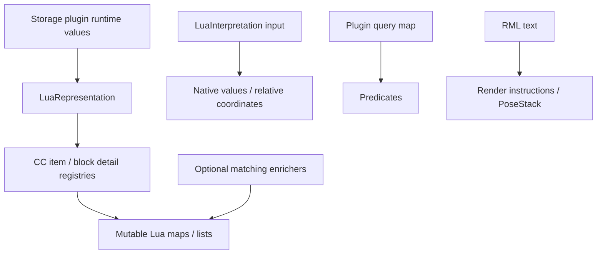
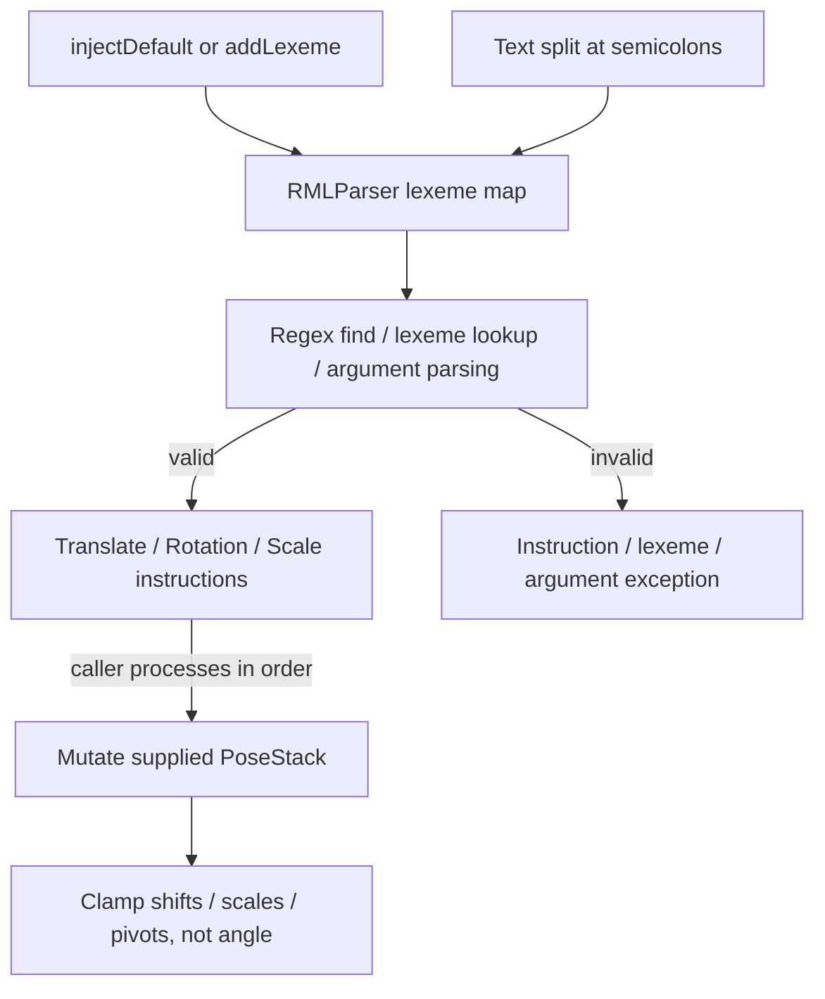
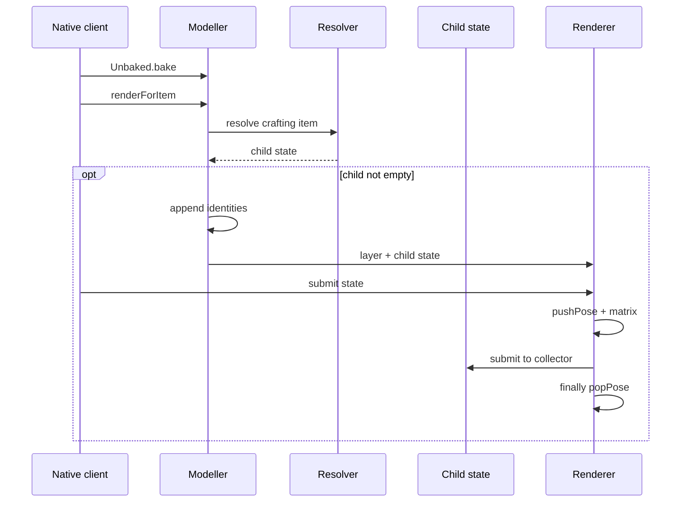

# Tweakium Lua representations and RML transforms

[Architecture overview](../../architecture/overview.md) · [Peripheral module map](peripheral.md) · [Client registration](../integrations/loaders.md#physically-client-only-model-registration)

## Logical representation boundary

Arrows show data flow, not automatic reversible conversion. Target item detail conversion requires [an active registry context](../../../projects/tweakium/versions/26.1.2/src/main/kotlin/site/siredvin/tweakium/modules/peripheral/representation/LuaRepresentation.kt#L101-L116); BASE/DETAILED delegate CC, FULL adds component-derived `rawNBT`. [Fluid output](../../../projects/tweakium/versions/26.1.2/src/main/kotlin/site/siredvin/tweakium/modules/peripheral/representation/LuaRepresentation.kt#L125-L135) keeps both truncated `amount` and `precise_amount`. These values are not an untyped lossless persistence protocol. Schema/version and enricher details remain below; [storage plugin listing](../../../projects/tweakium/src/main/kotlin/site/siredvin/tweakium/modules/plugins/AbstractItemStoragePlugin.kt#L30-L41) is a concrete caller.

## RML transform flow

[Parser](../../../projects/tweakium/src/main/kotlin/site/siredvin/tweakium/modules/rml1/Toolkit.kt#L29-L55) owns registration and instruction creation; [operations](../../../projects/tweakium/src/main/kotlin/site/siredvin/tweakium/modules/rml1/Operations.kt#L7-L101) own processing. [RMLTests](../../../projects/tweakium/src/test/kotlin/site/siredvin/tweakium/RMLTests.kt#L14-L34) checks parse and unknown lexeme, not rendered geometry. RML is not a hardened full-string grammar, and no implicit connection to every modeller is asserted.

## Client model extraction and submission (26.1.2)

This is client rendering, not owner/plugin composition. [Target extraction/bake/submission](../../../projects/tweakium/versions/26.1.2/src/main/kotlin/site/siredvin/tweakium/modules/turtle/client/FacingBlockTurtleModeller.kt#L26-L73) uses fixed side matrices and child state, not a live world read during submission; no new worker-thread scheduler is introduced by this class. [1.20.1](../../../projects/tweakium/src/main/kotlin/site/siredvin/tweakium/modules/turtle/client/FacingBlockTurtleModeller.kt#L12-L24) and [1.21.1](../../../projects/tweakium/versions/1.21.1/src/main/kotlin/site/siredvin/tweakium/modules/turtle/client/FacingBlockTurtleModeller.kt#L13-L25) instead return `TransformedModel` (the latter receives a component patch argument). Neither calls RMLParser. [Loader client gates](../integrations/loaders.md#physically-client-only-model-registration) own codec installation, while historical/current graphical acceptance remains below. This diagram is not a fresh Minecraft client execution.

## Current target rendering and schema boundary (2026-10-19)

Lua representation, map predicates and RML remain separate languages; output maps are not universally reversible input schemas. Target registry-aware item/enchantment/component adapters retain public Lua field identities while native Kotlin/CC signatures require target consumer recompilation. Runtime values remain ItemStack, definition templates resolve only with valid context.

FacingBlockTurtleModeller and RML target adapters use native extracted/model/material submission paths, not a permanent compatibility rewrite or live mutable world reads during submission. [R7 rendering](../../../docs/verification/minecraft-26-1-R7-rendering.md) and [final integration](../../../docs/verification/minecraft-26-1-R7-final-integration.md) retain six actual workflows,90 original PNGs,192 positive material submissions and equipped upgrade views across reload/reconnect. Parser unit tests alone are not this proof. No arbitrary third-party geometry, all numeric parser edges or hardened untrusted-RML grammar certification is implied; see [final limits](../../../docs/minecraft-26-1-verification.md).

## Historical source notes — October16 baseline

The following327f845/e69b721 notes remain useful grammar/schema background, but their unperformed-rendering statement is historical. Current target overrides and explicit rendering evidence above take precedence.

## Representation is a boundary, not a universal schema

LuaRepresentation converts blocks, entities, items, fluids, energy and other world values into mutable maps/lists. Item BASE/DETAILED modes delegate to ComputerCraft's detail registries; FULL adds rawNBT. Block V2 similarly delegates to the block-in-world detail registry and adds displayName. Thus extension data supplied by CC detail registries can affect results; not every table is hard-coded here.

Position helpers subtract a center and transform to facing-relative coordinates. LuaInterpretation reverses that orientation for relative positions/vectors, requires numeric x/y/z and converts block coordinates to Int. It accepts item IDs or maps with item/count, validates resource IDs through asID, and builds block states from named properties. These are distinct input schemas: the item output's name field is not the input map's item field. There is no promise every output table can round-trip unchanged.

Enrichers are BiConsumers mutating caller maps when entity/block types match: animal, effects, merchant/villager, properties/crop/honey and beehive data. They are reusable optional functions rather than a global automatic enrichment pipeline. Preserve exact output keys when changing APIs; for example the shared animal enricher emits shareable, not a corrected spelling inferred by a client.

## Version and precision contracts

In 1.20.1 forEnchantment accepts Enchantment and derives name from the description ID. The 1.21.1 override accepts Holder<Enchantment>, emits registeredName and uses Enchantment.getFullname(holder,level). Both enchantment collection signatures also change their key type. Consumers need source/binary compatibility review, not just an unchanged Lua field name.

FULL item rawNBT comes from legacy stack.tag in 1.20.1 and a converted nonempty componentsPatch in 1.21.1. The name rawNBT remains even when the representation underneath is components. Fluid output provides amount truncated to Long and precise_amount retaining Double, with optional nbt hash derived from tag or component patch by version. Do not use rounded amount to reconstruct fractional fluid state.

## Three different languages

PeripheralPluginUtils map filters accept item/block query maps with predicates; they are described in [plugins](plugins.md). They are not RML.

RML means Render Markup Language. RMLParser splits instructions by semicolon, regex-extracts lexeme(arguments), resolves registered lexemes and builds RenderInstructions. injectDefault adds t, r and s. Examples matching current tests/source are:

    t(1, 2, 3);r(x, 90, 0, 0, 0)
    s(0.3, 0.3, 0.3)

The package comment's draft dotted syntax is not the implemented grammar. Translation and scale require three floats; rotation takes lower-case x/y/z, angle in degrees and three pivot offsets. Processing mutates the supplied PoseStack in sequence. Translation, scale and rotation pivots clamp to -4..4 at processing time; angle is not clamped. Lexeme registration replaces by name. An empty parser has no defaults until injected.

The parser uses regex find, not a complete tokenizer or full-string match. It has no explicit finite-number check, robust nested grammar or trailing-semicolon normalization. Wrong counts/numbers, malformed instruction and unknown lexeme have distinct error routes. Do not treat it as a hardened untrusted-input language merely because coordinate values are clamped.

## Tests and extension seams

RMLTests checks a translation/rotation parse and unknown-lexeme failure. It does not exercise PoseStack effects, all parser errors or every numeric edge. The inspected FacingBlockTurtleModeller directly builds a fixed PoseStack transform and returns a transformed crafting-item model; that file does not invoke RML, so parser existence is not evidence of automatic integration into every renderer.

Add conversions/enrichers where the owning API requires them and update [typed client contracts](../../typed-peripheral-api/contracts.md) when exposed. A new RMLLexeme must be registered deliberately. No JVM/client/rendering tests were executed during wiki creation.
