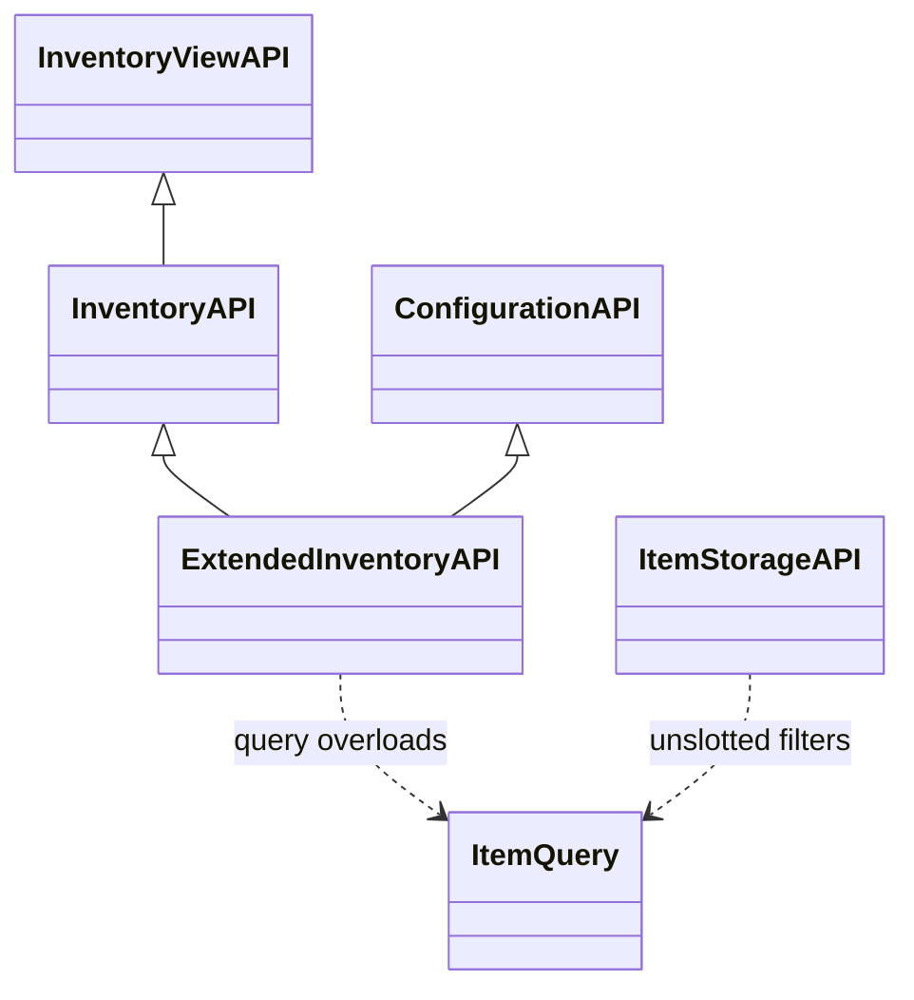
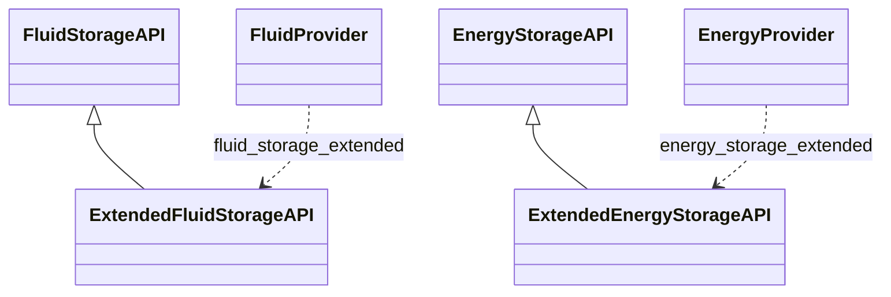
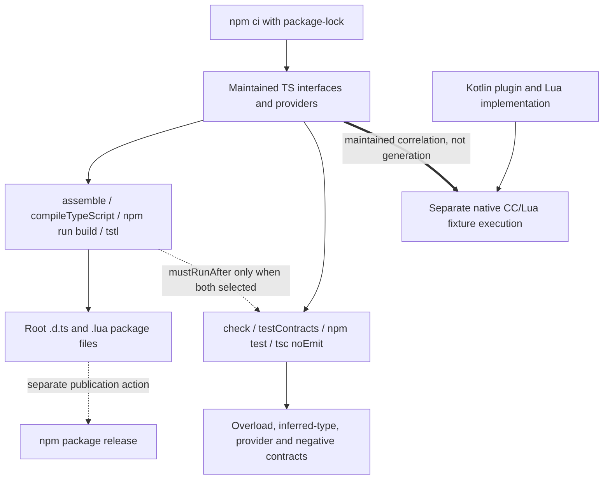

# Typed peripheral API contracts and packaging

[Architecture overview](../architecture/overview.md) · [Version/loader topology](../architecture/loaders.md)

## Interface and provider model

### Native-resource interface and provider families

Inheritance arrows express TypeScript interface composition, dotted arrows type/provider use. FluidProvider/EnergyProvider are diagram labels for the exported IPeripheralProvider instances, not new classes; these are not generated Kotlin classes. [Inventory](../../projects/typed-peripheral-api/inventory.ts#L4-L21), [extended inventory](../../projects/typed-peripheral-api/inventory_extended.ts#L10-L54), [fluid](../../projects/typed-peripheral-api/fluid_storage_extended.ts#L4-L14) and [energy](../../projects/typed-peripheral-api/energy_storage_extended.ts#L4-L14) show actual composition and wire names. Extended inventory specializes ConfigurationAPI with ExtendedInventoryConfiguration. Provider constructors come from external typed-peripheral-base and use null fallback callbacks; the diagram does not claim their discovery internals are implemented here. Other behavior APIs (scan, look, capture, fuel, operations, interaction, experience, suck, warp and Creative Filler) are contract surfaces, not a single inheritance tree; [contracts.ts imports and calls them](../../projects/typed-peripheral-api/tests/contracts.ts#L1-L99). Exhaustive UML would obscure that independent composition.

### Compiler checks, emission and runtime correlation

[Gradle wiring](../../projects/typed-peripheral-api/build.gradle.kts#L17-L50), [npm scripts/files](../../projects/typed-peripheral-api/package.json#L5-L19) and [noEmit test config](../../projects/typed-peripheral-api/tests/tsconfig.json#L1-L7) ground the two compiler routes. `mustRunAfter` orders jointly selected tasks without forcing emission for standalone contracts. Thick correlation is a separate obligation against [Tweakium plugin behavior](../tweakium/modules/plugins.md#small-plugin-family-model), not Kotlin-to-TypeScript generation. Type equality and expected errors do not execute emitted Lua or prove range, conservation, units, schema parity or transactional behavior. This documentation run neither reruns those compilers/native fixtures nor publishes npm artifacts; historical receipts and retained limits follow below.

## Current compiler/runtime correlation (2026-10-19)

This package remains independent of Stonecutter and library2.0.0 versions. Gradle check runs the no-emission compiler contracts, ordered after emission only when both tasks are selected. Runtime Lua names, schemas, error results and numeric/unit limits remain separate obligations: TypeScript number is not a conservation or precision guarantee.

[R3](../../docs/verification/minecraft-26-1-R3.md) and [R7 legacy](../../docs/verification/minecraft-26-1-R7-legacy.md) correlate native CC/Lua behavior with declarations; final integration replays the stronger Creative Filler fixture on both target loaders and forced TypeScript contracts. Maintained predicates now reject malformed/unknown/empty operations; the historical parser-ignore finding below is not current behavior. [Final R7](../../docs/verification/minecraft-26-1-R7-final-integration.md) binds actual source/artifacts, not just matching method names.

Inherited strict-null dependency errors and npm advisory remain explicit in existing triage t_470a1973. Compiler mutation evidence is not a clean dependency audit or universal emitted-Lua conformance. No npm release was performed.

## Historical source notes — October16 baseline

The following327f845/e69b721 package/type inventory and mutation results remain historical provenance; later real Lua correlation above supersedes its then-unperformed-runtime statement without inventing complete schema certification.

## Separate consumer-facing boundary

projects/typed-peripheral-api is included by settings.gradle.kts as its own Gradle subproject, but is not among the four Stonecutter trees. It supplies TypeScript interfaces and a few executable provider/dummy helpers for ComputerCraft clients, not Minecraft registry or loader entrypoints. The package is @siredvin/typed-peripheral-api, version 0.2.2 in the inspected manifest. Do not infer its version from the Kotlin libraries' gradle.properties.

The Gradle base/Node build downloads Node 22.14.0 into root .gradle directories, uses npm ci, and makes assemble depend on compileTypeScript (npm run build). TypeScript-to-Lua emits declarations and Lua alongside the source; clean deletes those .d.ts/.lua outputs. tsconfig targets Lua 5.1 library mode with require-minimal support and TypeScript declarations enabled, but strict checking disabled. The npm files list publishes root .d.ts and .lua files; Gradle assembly is not proof of npm publication. Dependency ranges include wildcard typed-peripheral-base, TypeScript and TypeScript-to-Lua, so preserve/review package-lock.json for reproducibility rather than deriving exact resolution from package.json.

## Interface composition and runtime entrypoints

Interfaces marked @noSelf express peripheral-style calls without an implicit Lua self argument. InventoryAPI extends InventoryViewAPI and declares numeric-slot pushItems/pullItems. ExtendedInventoryAPI combines that contract with ConfigurationAPI<ExtendedInventoryConfiguration>, adds detailed/query list overloads and accepts either numeric slots or ItemQuery filters in transfers. Its configuration includes inventoryTransferLimit. ItemStorageAPI provides unslotted query-based items/pushItem/pullItem. Fluid and energy extended interfaces compose their base APIs and add precision/capacity or transfer methods.

Exported IPeripheralProvider instances use wire type names such as inventory, inventory_extended, item_storage, fluid_storage_extended and energy_storage_extended. Their fallback callbacks return null; lookup/discovery behavior belongs to the external typed-peripheral-base dependency, not an implementation in this repository. Changing a Kotlin plugin's additional type name without changing this package can break discovery even when method signatures still compile.

Most files declare contracts rather than real peripherals. DummyFuelApi is an exception: it returns fixed fuel levels and stores the consumption rate in a module-global variable shared between instances. Its setter returns a successful Lua multi-result without the bounds checks of the Kotlin FuelBoon. It is a dummy, not a simulator proving production fuel behavior. OperationApi separately declares getOperations/getCooldown; ConfigurationAPI only declares getConfiguration, not a generic configuration mutation method.

## Match effective Lua behavior, not just names

ItemQuery and BlockQuery describe optional aliases and recursively composed OR/AND/NONE/NOT maps. They are client-side types, not runtime validators. The Kotlin parser ignores unknown map fields and has empty-composition failure edges; callers must still handle Lua errors. The TS declarations are not generated from Kotlin, and TResult/LuaTable types cannot prove runtime shape, slot semantics, numeric range or transactional behavior. See [storage plugins and operations](../tweakium/modules/plugins.md).

ScanApi gives overloads for item, block, entity, player and xp results. Its block-state type allows string/number/boolean, while the shared LuaRepresentation.forBlockState stringifies values. This is a broader client type rather than evidence of all possible runtime values. Position orientation, component/enchantment version differences and rawNBT semantics remain owned by [representation](../tweakium/modules/representation-rml.md). Kotlin Long/Double narrowing and fluid units need separate review even though TypeScript calls them all number.

## Extension and verification

For a new API, coordinate the Kotlin plugin's method names, additional type name, table schema and error/multi-result behavior with its TypeScript interface and provider. Add a root .ts file to tsconfig's explicit include list when appropriate; preserve existing consumer contracts.

npm test now invokes tsc with tests/tsconfig.json and noEmit. Gradle check depends on testContracts; it mustRunAfter compileTypeScript when both are selected, avoiding declaration-file read/write overlap without requiring emission for standalone checks. The contract suite compares inferred types in both directions and rejects any erasure, calls every inventory/item-storage list overload, all five scan modes, and both wrapping overloads of all nine exported providers. Twelve expected-error directives protect invalid arguments and scan filters.

The coverage task passed standalone and combined builds and replayed compiler mutations: 66 of 67 detected, all 12 negative diagnostics verified for the intended reason. Removing null remains undetected with inherited strictNullChecks disabled; enabling it exposes five errors in dependency TypeScript source. No suppression conceals this limit. The inherited dependency audit also reports one high-severity picomatch advisory; dependency remediation was not bundled into the contract-test patch. These checks do not execute emitted Lua or prove runtime client/server schema parity. [Build/publication](../build/stonecutter-publication.md) and [verification](../testing/verification.md) distinguish packaging, compiler assertions and runtime evidence.
